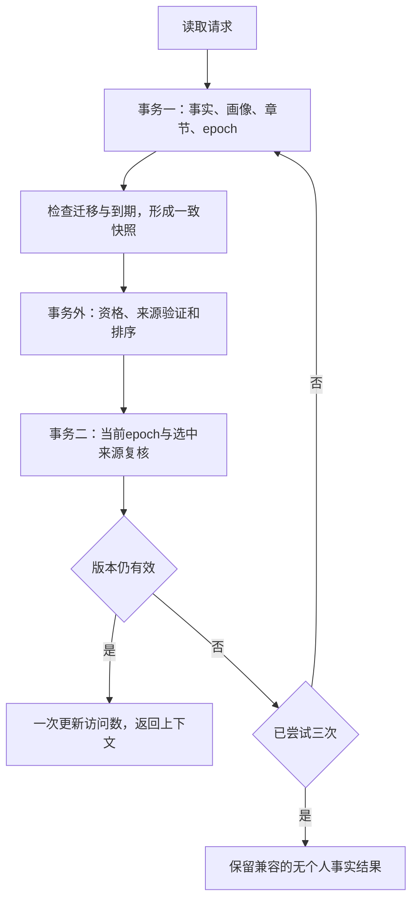

> 历史记录：本页记录第一批一致性补丁及当时的性能，不代表第二批按需 RAG 的当前实现。第二批入口见 [README](README.md)、[检索评测](ondemand-evaluation.md)、[持久向量](persistent-vector-cache.md) 和 `ondemand-validation.json`。

# 本次交付、迁移与实测结果

日期：2026-11-01。固定基线：`238f361c856584c7f93cc15dca5cbf5a387393e8`，PR #6已合并。
本地分支：`codex/memory-integrity-20261101`。启动及交付前核对均无开放PR，main仍为上述提交；本轮不修改远端。
测试、基准全部使用合成临时存档。生产源码、依赖声明、测试和文档的最终差异随补丁交付。

## 1. 实际完成的增量

| 问题 | 本轮实现 | 验证范围 |
| --- | --- | --- |
| 相册更正正文后仍带旧结构值，主动说话可能重复旧值 | 新增共享`memory_correction.py`；先清理旧事实原子和原文证据，再解析当前更正文 | 经过相册控制器、存储和主动反馈选择器；不可解析的文本保留为普通笔记 |
| 只改metadata不触发来源失效 | 净化后的语义metadata加入证据指纹，键序确定 | 主体/字段/值、证据文字、场景等变化会使旧派生失效；纯记录/诊断字段不变更含义指纹 |
| self事实可纠正到无关字段 | 主机校验当前字段；旧无结构记录只用已有规范文本识别 | 错目标被澄清且原事实保留；关系人物既有校验保留 |
| 同批互斥候选先后写入 | 写入前检查单值字段冲突，包含第一值已存在并会被去重的情况 | 单值冲突整批不写；多个合法兴趣仍可并存 |
| 连续纠正累积祖先来源，达到8个后失败 | 当前版本只存本次直接来源，`supersedes`保留版本链 | auto/review各260次连续纠正，祖先链与从原始ID遗忘后续版本 |
| 超过300条静默丢弃权威事实 | 移除四个写入路径的容量截断；保留构造参数兼容 | 301条常规写入后最早置顶事实仍存在；小max_entries下各写入路径不截断 |
| 人格在两层预算中丢身份或作者边界 | 保留schema、角色ID/名字、标题、描述、语气、全部作者边界、版本/hash；先裁可选项 | 合法大persona、中英/转义/emoji、键顺序、真实草稿/修订prompt构造；核心实在装不下明确报错 |
| 每轮上下文反复全量事务 | 一致快照读取、事务外检索、原子finalize；稳定请求2次事务 | TTL、来源、并发纠正/遗忘/画像变化、重复ID、访问统计与存储错误传播 |
| Linux全量测试的ffmpeg假程序不可执行 | POSIX使用带shell引用的可执行包装；Windows保留原cmd假程序 | 原测试文件4项通过；不作为真实视频转码证明 |

本轮源码没有修改角色资产、插件SDK、移动客户端或模型依赖声明。既有FastEmbed0.9.1/BGE保持。
真实生成模型、Windows打包与手机真机属于后续验收项。

## 2. 新上下文读取路径



没有引入跨轮快照缓存。语义回调不占SQLite写锁。第二个事务核对epoch、当前指纹、
owner/角色、scope、时间、retired和active状态；任何选中项失效时不写访问次数。
其他并发召回已经增加的计数会保留。最终事务之后的撤销仍由既有发布层epoch屏障处理。

重复ID遵循现有写入的“最后一个有效、同owner/角色行”规则，再做资格过滤；
不会用早期active副本绕过当前失效版本。未选中的原始行保留，不在召回时隐式清洗数据。
存储仍为单JSON文档，每次事务仍需全量JSON处理，复杂度仍随记录量增长。

三次冲突后的空结果是兼容行为；后续B1需要让接口区分“暂不可用”和“没有相关记忆”。
本轮没有增加未接通的公开异常类型。新无关事实或新章节不一定推进撤销epoch，
因此允许读取略旧、来源仍有效的一致快照。

## 3. 旧存档升级与兼容

路径保持`<user_data>/characters/<character_id>/memory_v2/`，非默认owner仍使用其独立目录。
SQLite格式仍为schema 2、同一个`memory_state`文档，首次读取在既有事务中写入
`migrations.semantic_metadata_fingerprint_v1`。以后命中标记即返回，不反复全库迁移。

升级处理：

1. 普通旧事实保持ID、正文、时间、版本、来源与作用域。原派生指纹确实匹配旧记录时才转换为新指纹。
2. 只针对带明确旧用户更正标记的active记录检查正文/结构矛盾；可解析则修正结构，否则保留用户正文为笔记。
3. 修复含义的记录版本加1，依赖它的旧画像/章节撤销；旧候选不因迁移而重新获得有效资格。
4. 已退役、缺来源、指纹不匹配的派生项不重新认证。epoch仅在这次含义指纹升级需要时推进一次。
5. 有效旧pending的来源和expected_epoch在同一事务转换；到期版本标记也转换，避免重复到期。

`source_ids`现在表示当前版本的直接证据。旧累积数组原样留在前驱记录，历史通过`supersedes`查找。
旧有调用签名保留；`max_entries`仍可传入，但不再控制权威数据留存。

上线前应关闭应用，在完整用户目录副本上先升级，核对各角色的有效事实、派生、pending和撤销记录。
如果回退代码，使用匹配的完整备份副本，保留升级后的原目录；旧程序不理解新指纹，且可能再次执行300条截断。
本轮没有无损原地降级工具。已被旧截断物理丢失的记录需要已有备份；迁移不能重建从未保留下来的历史。
逻辑遗忘继续保留审计历史，不等于所有文件、备份和外部服务的物理删除。

## 4. 实际代码验证

| 验证层 | 修改前 | 修改后 |
| --- | --- | --- |
| 18条冻结记忆一致性回归，同一文件、固定原版源码 | 15失败 / 3通过 | 18通过 |
| 10条人格预算回归 | 9失败 / 1通过 | 新增用例及对应实际prompt路径通过；最终全量结果见下 |
| 18条快照/并发回归，优化前后同集 | 11失败 / 7通过 | 18通过 |
| 既有记忆相关聚焦测试 | — | 297通过 / 2跳过 |
| 合入快照后的相关聚焦测试，包含长纠正链 | — | 182通过 / 2跳过 |
| 最终全量pytest | — | 1789通过 / 6跳过 / 0失败，1条既有告警；550.02秒 |

最终全量中46项新增回归全部通过。6项跳过为4项需显式启用的真实生成测试，以及pytest环境未安装FastEmbed的2项真实embedding测试；独立检索环境的真实BGE测量另列。1条告警来自既有端口占用测试的Uvicorn线程SystemExit。

聚焦测试有重叠，不能把通过数相加当成不同覆盖。人格聚焦里曾有本机HTTP端口权限错误，
获得测试所需本机端口权限后单测通过；保留中间日志，最终以全量结果为准。
测试编写时的fixture错误单列，不计入产品失败基线。

全量完成后仅删除新增文件末尾的多余空行；Python文件AST逐一对照不变，测试时的原文件和前后hash另存，未改变可执行行为。

机器可读实测见[measured-results.json](measured-results.json)；最终全量和源码一致性见
[validation-summary.json](validation-summary.json)。完整原始日志、XML、逐题请求和hash随开发证据包交付。

## 5. RAG检索实验：沿用真实模型，比较现有路线

50道合成开发查询：36道有相关证据、14道无相关有效个人证据。300与3000使用同一组查询，
并非两组独立测试。3000条包含8类模板扩充，短摘要中位25字符、最长31字符；不能当作真实多年生活语料。
生产代码固定在原版238f361，FastEmbed0.9.1、CPU两线程、BGE中文小模型固定revision；未调阈值后重筛题。

| 路线 | 宏平均Recall@4 | 完整证据进入请求 | 无证据题仍注入个人记忆 |
| --- | ---: | ---: | ---: |
| 生产词法 | 77.78% | 27/36 | 6/14 |
| BGE语义单路诊断对照 | 97.22% | 35/36 | 12/14 |
| 生产当前RRF | 97.22% | 35/36 | 13/14 |

这三项在两种规模相同。语义单路不是产品第三个设置开关。
词法77.78%是逐题召回比例平均，不能写成28道完整成功；其中两道只召回了一半所需证据。
所有逐题retrieved_ids与delivered_ids已核对一致，因此无关注入确实到达构造出的ExpressionRequest；
没有发送给生成模型，不能当作回答幻觉率。符合资格的错误相关项与已删除记忆泄露也应分开。

现有原始字段`macro_precision_at_4`以实际返回条数作分母，正确阅读名称为“最多4条返回结果的宏平均精确率”。
该指标在3000规模为词法60.88%、语义58.80%、RRF52.78%，说明召回增多也带来额外噪声。

真实bad case：

- 问牙医姓名，却注入用户的吉他老师姓名。其他owner的牙医事实正确过滤了，关系类型和未知判断仍不足。
- 问已经遗忘的流星雨经历，旧事件没有返回，但RRF塞入四条无关相册分类记忆。重复候选和无答案门控需要改进。
- “替我点一碗面，有哪种配菜需要去掉？”没有召回已有“不放香菜”事实，三条路线都漏了。这是场景到偏好的语义联系缺口。

语义检索在这个开发集改善改写召回；本轮代码修复改善生命周期和上下文一致性。
两种证据分别成立，不能将97.22%描述为“本轮升级后的总体记忆准确率”。

## 6. 性能：检索、存储和生成分开计时

环境：Linux、AMD EPYC 9V74、Python3.12.14；真实BGE CPU推理2线程。
生成模型、网络首答、Qt事件循环、Windows和手机未参与这次延迟测量。

### 6.1 现有检索与请求构造的热路径

| 路线p95 | 300条 | 3000条 |
| --- | ---: | ---: |
| 词法+请求构造 | 15.1ms | 145.1ms |
| 语义单路诊断+请求构造 | 9.0ms | 33.2ms |
| 当前RRF+请求构造 | 25.8ms | 191.2ms |

50题；语义/RRF去掉首次建立索引的冷查询后49个暖样本。这不是完整SQLite上下文构建时间。
首次索引约2.67秒/22.63秒（290/2990条有效输入）；模型权重约94.8MB，
索引后全进程RSS约570/664MiB。后者含运行时、批处理缓存和同进程前一次规模的分配器缓存，
不能当作纯模型内存或独立干净进程的两个规模增量。
当前invalidate清空向量；角色/场景切换和撤销后可能重新编码，后续B3b需增量化。

### 6.2 真实SQLite服务前后对照

同一数据、脚本、解释器，源码在各自运行中冻结。旧版显式设`max_entries=规模`以允许公平测3000条；
旧默认配置原本会截断。输入300/3000中有两条外owner/角色记录，同库实际298/2998。
八个相同查询，全部返回的证据ID前后一致。每规模的一次纠正、一次遗忘只能报点测。

| 操作 | 300条原版→本轮 | 3000条原版→本轮 |
| --- | ---: | ---: |
| load_memories p50 | 27.1→25.0ms | 289.7→243.6ms |
| build_context p50 | 224.3→43.3ms | 2187.6→425.3ms |
| build_context p95 | 278.5→52.6ms | 2395.4→456.2ms |
| 一次纠正 | 105.1→101.2ms | 1000.7→932.2ms |
| 一次遗忘 | 101.9→65.0ms | 639.2→624.0ms |

本轮上下文构建中位耗时下降约81%，快约5.1倍。样本小且为合成数据，p95用于开发比较，
不作为真实设备SLO。其他操作没有相同比例改善，不能说整个记忆系统都快5倍。
3000条上下文仍约0.43秒，尚未达到本包拟定的几千条完整本地路径p95约200ms目标。
完整自然聊天还包含提取、embedding准备、表达生成/修订等阶段，不能用此表代表用户等待时间。

## 7. RAG与后续优先级

采用[ADR](adr-memory-rag.md)中的分类型读取。人格直接提供，明确事实按主体/字段/时间查询，
经历用混合检索，外部状态用权威接口。维持一套SQLite事实权威，索引可重建。

下一批按B1共享入口、B2实体/时间契约、B3a相关性与未知问题、B3b存储和增量索引、
B4共同经历与人格行为推进。B3a不用等待完整数据库改造，当前误注入就是其具体需求依据。
手机M0先修已有跨端一致性；之后M1-M5日常连接、Android执行、长程任务、观察、iOS/原生鸿蒙分别交付。
每项具体条件见[requirements.md](requirements.md)、[handoff.md](handoff.md)和[完整评测计划](evaluation-plan.md)。

## 8. 复跑

```bash
python -m pip install -e '.[test,host,semantic]'
python -m pytest
python tools/eval_personal_memory_retrieval.py \
  --source-root /path/to/frozen-repository \
  --store-only --sizes 300 3000 --output /path/to/store-result.json
python tools/eval_personal_memory_retrieval.py \
  --source-root /path/to/frozen-repository \
  --sizes 300 3000 --model-cache /path/to/model-cache \
  --local-files-only --output /path/to/retrieval-result.json
```

未缓存模型时先按应用已有流程下载；移除local-files-only会允许公开模型下载。
Linux无显示环境使用QT_QPA_PLATFORM=offscreen，并补齐Qt系统库；本机HTTP测试需要可监听回环地址。
真实模型测试使用项目现有显式开关和已授权配置，默认测试成绩不自动包含真实模型。

补丁应用先用`git apply --check`检查；若最新main/PR已包含同项修复，逐项比较再合并。
开发包不带真实用户存档、provider密钥、模型权重或第三方角色资产。
