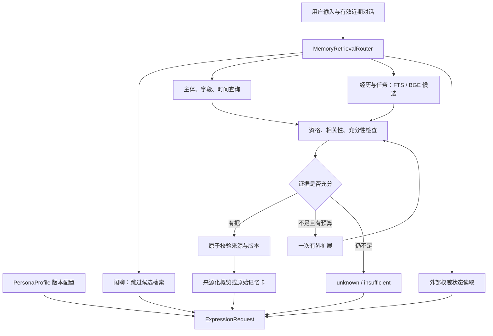
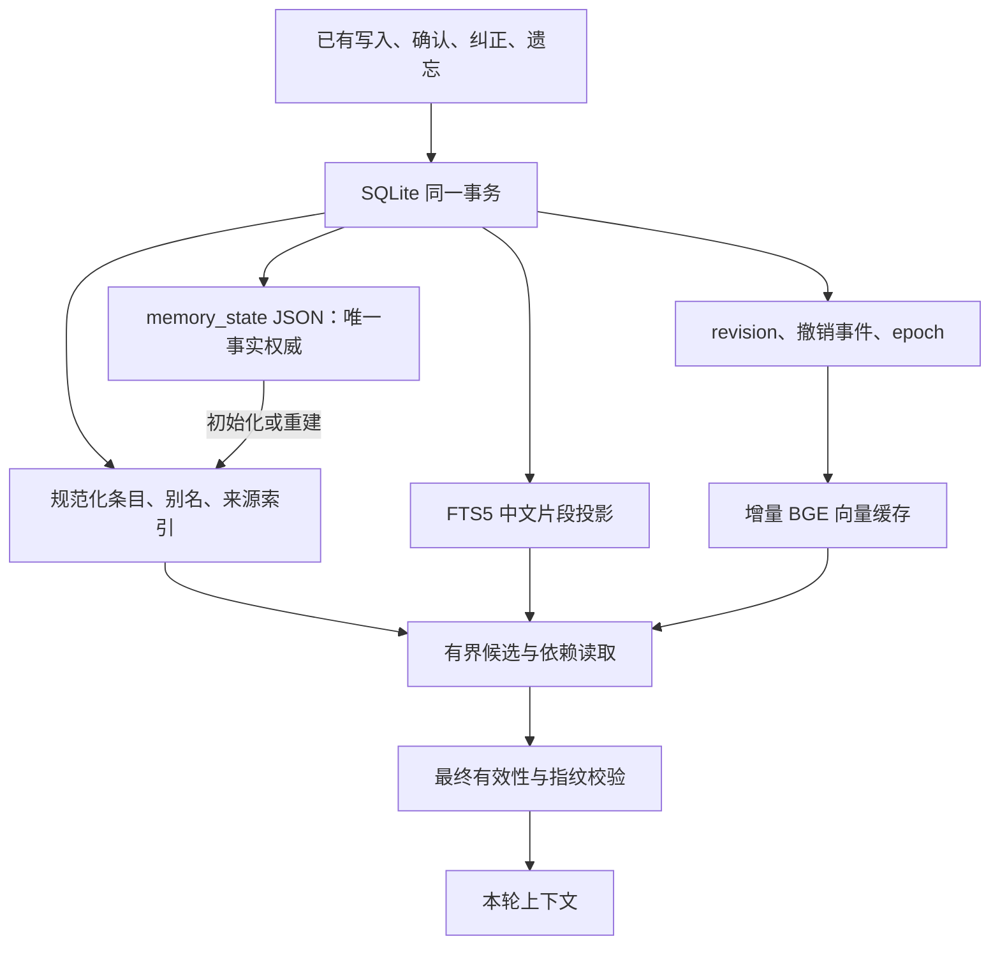

# 按需记忆架构：一个权威体系，按证据需求读取

本页对应 2026-11-01 的第二批增量开发。远端核查基线为 `238f361c856584c7f93cc15dca5cbf5a387393e8`；上一批一致性补丁完整复用为本地先决提交 `299a0aa568c90525e6a6a90ce01dbbf80bfaefcb`。本页与 [检索契约](retrieval-contract.md)、[存储迁移](storage-index-v1.md)、[评测](ondemand-evaluation.md) 一起使用。第一批数据仍是历史基线，不能当成本批成绩。

## 1. 产品目标与职责

E-Moti 独立运行。人格、陪伴和记忆不依赖工作插件。角色配置由作者/用户管理，事实由有来源的记忆管理，情绪调整本轮表达。关闭 Relay、游戏和手机功能，不会取消聊天、角色身份或共同回忆。

| 信息 | 当前权威 | 读取方法 | 修改入口 | 不能推断的内容 |
|---|---|---|---|---|
| 稳定人格 | Character Pack / PersonaProfile 的版本化配置 | 直接加载、配置哈希、必需字段预算保护 | 角色配置编辑 | 一次聊天不能改写核心身份；检索结果不写 persona |
| 用户事实与偏好 | 角色/owner 隔离的 EmotionalMemoryEntry | 主体、字段、有效时间索引，必要时有界词法补充 | ChatMemory、确认、correct、forget | 不从主题相似度推出姓名、过敏、住址等具体事实 |
| 共同经历 | 已发生事件的来源化记忆 | 词法与 BGE 候选，事件真实性门槛，L1/L2 视图 | 游戏/已确认陪伴事件及经校验的事件输入 | 计划、模型叙述、外部临时观察不能自动成为共同过去 |
| 近期上下文和情绪 | 有界 recent_dialogue、宿主状态 | 当前角色、当前 context_epoch 的窗口 | 正常对话与宿主状态机 | 旧窗口不能绕过纠正/遗忘；情绪不改写事实 |
| 任务经验 | 同一 SQLite 中的 task_experience scope | app/version/outcome 与主题检索，前提随证据传递 | 可信执行器记录接口 | 上次成功不能证明当前任务成功；计划不等于执行 |
| 外部实时状态 | Relay/游戏/手机等原系统 | ExternalStateReader 返回有时效的证据 | 外部系统自己 | E-Moti 不持有第二套任务权威，不默认长期保存状态 |

这里的“权威”指本地接受、修改和撤回事实的唯一位置，不代表记录内容在现实世界绝对正确。用户仍可检查并纠正它。

## 2. 实际数据流

生产入口是 `EmotionalMemoryService.build_context()` → `retrieve()`。桌面对话准备调用 `prepare_retrieval()`，只有经历、任务和歧义检索需要可选 embedding worker。人格、明确事实、闲聊、实时状态不为了路由额外请求模型。`build_legacy_context()` 保留为对照和兼容诊断路径，桌面默认已经使用新入口。

近期指代只从有效用户轮次继承，既不会把 assistant 的猜测升级为事实，也不会跨角色或跨撤销 epoch 继承。无法唯一解析“他/那次”时返回不足状态，保留需要澄清的原因。

## 3. 一份事实权威与可重建投影

投影和权威记录在同一个 SQLite 文件中。旧 V2 JSON、角色存档以及初始迁移协议保留。写事务更新 JSON 后同步条目、别名、来源、FTS 和变更事件；`dirty` 触发器覆盖旧接口或外部 SQL 写入。投影丢失可从当前权威重建；权威文件损坏或丢失不能退回陈旧 JSON“恢复”已遗忘的信息。

普通精确查询不再完整解析全部 JSON。它读取资格元数据、匹配条目及必要来源。回忆访问计数通过 JSON1 只定位选中行更新，避免 Python 解析全部条目；SQLite 仍需序列化 JSON 文本。因此本轮主要消除读取、重复编码和不必要检索的成本，纠正/遗忘等完整语义写入仍可能随记忆量增长。真实成本见存储结果，不能用向量更新耗时替代整个事务耗时。

## 4. 事实的主体、时间和版本

主体优先使用 `fact_subject`，自我事实是 `user:self`，已有关系标签是 `relation:<原话标签>`。显式 `entity_id` 和来源支持的别名用于多跳查询。字段沿用 `fact_predicate/fact_slot/fact_domain`，没有从模型自由生成新的主键或关系。别名解析会返回姓名/别名绑定的来源，最终与答案来源一起验证；删除姓名绑定后不能继续凭旧别名缓存找到职业。

`valid_from/valid_until` 表示有效区间；`created_at` 表示记录时间；`occurred_at` 表示事实或事件发生时间。旧记录并不都带完整的现实时间标注，本轮不会为旧记录编造精确时间。逻辑时间、UTC 日期和真实事件时间应由写入接口明确选择，不能在前端暗自互换。

当前事实查询排除未来和过期条目。明确历史查询可以读取仍允许使用、只是有效期已结束的事实，并在上下文标为 history/as_of。显式遗忘、撤销、已退役的更正旧版本在任何时间模式下都不可检索。旧“纠正”语义本来就会退役旧正文，本轮不把它恢复成历史事实；正常状态变化若需保留可读历史，应使用不同有效区间的合法记录。此边界必须在产品中解释。

计划通过 `plan_status/event_status/outcome` 与已完成事件分离。任务经验需要实际执行来源和明确 outcome；问计划只能获得计划证据，问是否完成必须查实时权威或具体执行证据。`preconditions` 已作为原始证据字段保留，任意自然语言任务前提的完整语义匹配仍待实现；不能把应用/版本相符当成所有环境前提都满足。

## 5. 证据充分性不是 cosine 阈值

候选首先经过 owner、角色、scope、撤销、置信度及时间过滤。明确事实必须匹配主体与字段；牙医姓名不能被吉他老师姓名替代，喜欢某食材不能变成过敏信息。事件需有完成状态、参与方/可信宿主来源；计划与模型生成事件不满足真实经历条件。

第二步检查主题和用户要求的细节。当前实现包含具名主题、应用版本以及姓名、颜色、数量、地点、参与者、原因、操作步骤等检查。查到计时器修好的记录，只能证明修好与验证结果；若原文没有原因，不能回答“最初为什么坏了”。多条件问题会分别记录满足和缺失的证据。`sufficient` 是本地可解释策略的结论，不能被宣传成通用自然语言蕴含模型的保证；独立留出集专门测它的误判和误拒。

BGE 提供候选和排序信号，RRF 融合独立词法/语义排名。新路径不会给纯语义候选额外的词法票。默认最多一次有界扩展，允许零条证据。`unknown`、`insufficient`、`external_unavailable`、并发不可用各自含义不同，表达层必须区分。

## 6. 来源化分层的真实含义

L0 是主题、时间范围、来源数量等轻量目录信息；L1 是来源绑定的摘录式概览；L2 是当前有效的原始记忆记录及结构化字段。简单共同回忆采用 L1，详细追问加载 L2。它们是同一批事实的不同视图，不是三个事实数据库。

L1 每个 claim 保存 `source_memory_id`、内容指纹、发生时间，claim 文本必须等于有效来源的 summary。旧章节的自由文本不直接作为新主张送给模型；先验证其来源，再从来源生成本轮摘录。这个机制能机械验证“概览没有新增主张”，但不等于证明上游记录本身永远真实。

同一事件的多个卡片按来源集合去重，同一来源不会在概览和原始卡片中重复展示。当前关系次数按相连来源组保守计数，不把一个事件的多个证据 ID 直接算成多次经历；跨事件共用父级来源可能造成合并，后续需要明确 event_id/run_id 与来源片段模型。真实阶段性关系概览与任意用户事实分开。更正、遗忘、到期会先阻断旧来源，再重建派生内容，重建失败也不能把旧摘要放回来。

L2 目前展开的是权威记忆卡中的事实、事件和来源标识，**不是任意长度的原始会话全文或外部系统完整日志**。例如 ChatMemory 的 `original_quote` 可能含同轮多条事实，不能不经逐主张撤销检查就塞回 prompt。未来全文来源解析需补原文片段绑定、片段撤销与可信外部 source resolver。这是明确的后续工程项。

客户端可通过 `expand_sources({memory_id: fingerprint}, expected_epoch=..., now=...)` 将某次概览展开为 L2。接口不接受客户端缓存的旧正文作为证据，而是按 ID 重读当前权威投影，校验角色、scope、有效期、指纹及 epoch，最后再次校验来源。旧概览被撤回后展开返回 `unavailable`；找不到有效来源则返回 `unknown`。此接口已有后端测试，桌面“查看依据”按钮仍由 Claude 接入。

上下文存在两级预算：记忆服务预算、最终 provider 总提示预算。`memory_prompt_budget.py` 在后一级也按完整 claim 裁剪；来源被裁掉时同步调整摘要事件数、时间范围、关联别名依据和充分性状态。评测检查最终 provider prompt，不能把只出现在检索 trace 的 ID 算作已交付。

## 7. 人格连续性的三种证据

| 验证层 | 本轮机制 | 错误如何判断 |
|---|---|---|
| 配置稳定 | PersonaProfile config_hash、版本、角色作者边界不随检索/纠正/遗忘改变 | 同角色同配置，生命周期后哈希或必需身份字段改变即失败 |
| Prompt 送达 | 既有 persona 预算保护，ExpressionRequest 明确传递人格及检索状态 | 序列化/总预算删掉必需身份；过期旧事实经其他字段重入即失败 |
| 实际行为稳定 | 仍需真实模型、多轮、跨会话及用户体验评测 | 讨好、越界亲密、无据回忆、过度主动、已知信息反复询问等需看输出 |

前两层的通过不能自动证明第三层。本轮的生成测试与真人桌面体验执行状态在评测表中独立列出。好奇、有主见、适度吐槽以及安静陪伴继续由角色配置、行为策略与真实行为测试共同决定。

## 8. 手机与执行器接口保留

Android/HyperOS、iOS、华为原生 HarmonyOS 将共享同一人格版本与事实权威。手机离线投影必须标明 owner、character、版本和撤销游标；重新连接时先消费撤销/版本事件，再开放缓存给模型。任务经验、屏幕观察和实时状态必须有独立 scope、时效和来源。观测候选不是获准长期事实，不能自动污染人格或关系。

本轮只新增核心契约与检索能力，没有重写现有手机 UI、Relay、游戏 Agent 或硬件固件。已有相关工作继续保留。

## 9. 独立失败后的通用修复

第一版冻结代码在独立留出上过度拒绝，严格支持交付仅 0/33。第二次增量保留这一失败记录，改为开放 predicate 的来源字面核验、完整主体/物件限定、复合实体撤销保护、事件发生时间下推，以及受限 JSON 事实值的读写更正闭环。新的未知表达由“未找到支持”驱动，而不是把 schema 未列出的所有事实永久拒绝。完整结果和第二批独立问题见 Benchmark，不能复用已调优留出当未见集。

旧桌面时间是逻辑秒；service 默认 time_basis=logical。日历查询不与其混比，明确返回不足。Unix 档案的日期测试单独声明 time_basis=unix；事实看 valid interval，事件看 occurred_at。未来时钟迁移属于独立真实旧存档工作，不能以合成 Unix 测试证明已经完成。
