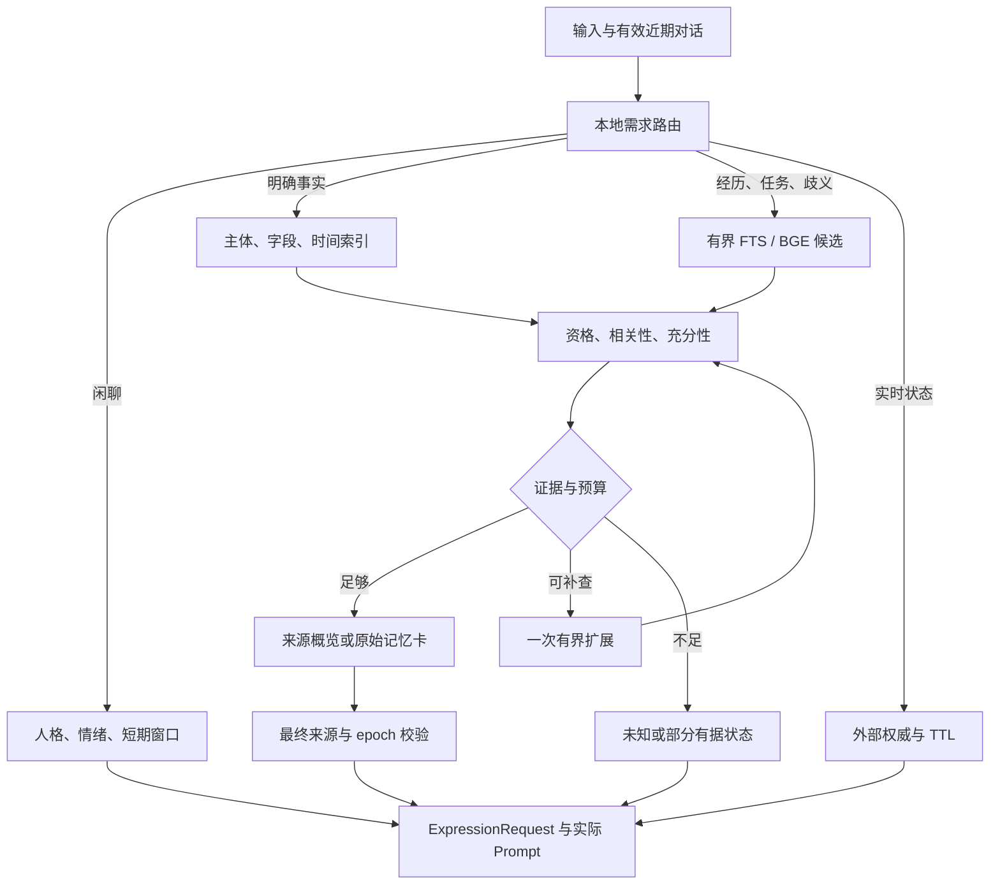
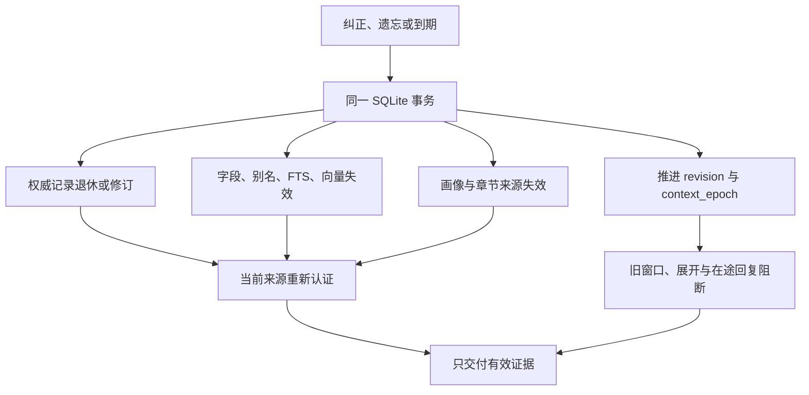

# E-Moti 按需 RAG、分层长期记忆与人格连续性：本轮交付报告

核查与执行日期：2026-11-01。本文是现有 Python/PySide6 工程的增量开发交付说明，汇总实际代码、证据、失败和下一阶段验收，不是独立 Demo 的介绍。项目内部的接口和逐项记录，以文末列出的架构、契约、存储、评测与交接文档为准。

## 1. 交付结论：基础设施明显改善，开放语言回忆仍未通过验收

本轮已把按需路由、结构化查询、同库 FTS/向量投影、来源化分层、最终上下文验证和增量维护接入实际桌面调用链。已有更正、遗忘、人物关系、角色隔离和人格预算代码得到保留，没有再建立一套竞争的长期事实数据库。

**目前不能宣称 E-Moti 已经全面更准确地回忆用户。** 第二份由独立作者准备、生产 `1eef5cb` 冻结后首次评分的 48 问中，新路径对 33 道有答案题仅有 **7 道完整交付正确证据**；无答案误注入为 **0/10**，但证据召回率由旧 BGE 的 **0.6970** 降为 **0.2121**。这是一种严重的过度拒绝，不能用“没有乱记”抵消“明明有记录却找不出来”。第一轮独立留出的 **0/33** 失败也完整保留。随后仅修复既有主体解析回归的 `b5b43e2` 重跑属于已见回归，不改写两次独立首次结果。[第二轮首次评分](../evidence/ondemand-memory-20261101/final-round2-sealed-300/first-score-diagnostic.json)和[第一轮失败报告](../evidence/ondemand-memory-20261101/f7-first-holdout-final-summary.md)是这一判断的直接依据。

**可以实证的改善是存储读取、重复编码成本以及更完整的来源生命周期。** 相同短文本语料的 10,000 条数据库读取加最终校验，中位耗时由 1,812.808 ms 降到 31.550 ms；固定 BGE 的同规模跨进程恢复与首问约 385.531 ms，不再重新编码 10,000 条。更正仍有秒级整份 JSON 写入，开放语言检索也未达标，二者均未被提速数字掩盖。[存储结果](../evidence/ondemand-memory-20261101/storage/storage-round2-comparison.json)；[真实 BGE 结果](../evidence/ondemand-memory-20261101/incremental-embedding/round2-10000/README.md)。

当前分支是**可审查、可复现的工程候选，存在检索质量发布阻断**。新策略已经成为该分支的默认桌面路径，尚未实现实验开关；不应只凭单元测试或读性能通过就直接替代发布版。真实生成回答、自然地表达未知和长期人格行为在本轮尚未执行，均保留 `not_run`。[默认路径审查](retrieval-release-assessment.md)给出了具体影响及整改方案。

## 2. 核查基线与已有工作复用

交付前在 2026-11-01 19:58 UTC 只读复核 GitHub：main 为 `238f361c856584c7f93cc15dca5cbf5a387393e8`，PR #6 已合并，没有开放 PR；没有推送、创建 PR、合并、发布 Release 或更改仓库可见性。[最终核查记录](../evidence/ondemand-memory-20261101/github-final-check.json)保存实际时间、分支和比较结果。

| 检查点 | 实际意义 |
| --- | --- |
| `238f361c856584c7f93cc15dca5cbf5a387393e8` | 核查时远端 main，不能仅凭历史聊天假定更多补丁已合并 |
| `299a0aa568c90525e6a6a90ce01dbbf80bfaefcb` | 完整复用已有一致性包的本地先决提交；旧检索对照固定在这里 |
| `f7a4e23a0f7b207fc68c1719c2217ac740416344` | 第一轮按需实现，独立留出失败后保留原始证据 |
| `1eef5cbb6f85703f0350f8708cc86bf84a7e071f` | 第二轮生产源码冻结；本报告两组主要性能和第二份独立首次评分对应此版本 |
| `53cb836dc8558fc1498db4c673207db4e7868f14` | 评测工具、数据及公平性契约检查点，生产代码与上一行相同 |
| `b5b43e2a83a392b56d11cd2c24f01a89bdf22364` | 最终生产冻结：修复既有具体主体被粗略提示覆盖的回归；存储和向量模块与 `1eef5cb` 字节相同 |

先决包的更正正文与结构字段一致、事实 metadata 指纹、单值冲突、连续修订来源链、移除 300 条静默截断、旧存档升级、人格预算、上下文一致快照和事务优化全部保留。此前 **1,789 passed / 6 skipped** 是该先决包的历史证据，不能写成本轮测试成绩。

本轮全量回归另外发现 8 个已有“人物姓名纠正后重启召回”参数测试失败：第一步已解析出的具体关系主体，被后续粗略所有格提示覆盖。`1eef5cb` 此次全量实际为 **2,136 passed / 8 failed / 4 skipped，609.85 秒**，完整保留在 [round2-tests/run.json](../evidence/ondemand-memory-20261101/round2-tests/run.json)。随后 `b5b43e2` 修复主体解析优先级，保留“同学租的仓库”等实际所有者动作语法，没有新增词表，也没有利用第二份留出的题目调规则。新增 6 项测试先复现 4 项失败再全部通过，既有 8 参数回归修复，相关 focused 共 135 项通过；focused 相互覆盖时不重复累加。

原始失败见 [subject-precedence-red.log](../evidence/ondemand-memory-20261101/round2-tests/subject-precedence-red.log)。最终全量测试以总体验证清单为准。质量重跑只重做受影响的 routed/layered 552 条，旧三方法 828 条按哈希复用，仍组成相同 1,380 条矩阵；第二份留出的新结果用途标为已见回归，不能覆盖独立首次评分。存储和向量性能模块未改，继续引用 `1eef5cb` 的真实测量，不虚称重新运行了性能测试。

最终冻结源码的完整测试已完成：**2,150 passed / 4 skipped / 0 failed，602.68 秒**，运行前后 `src/tests/tools` Python 文件哈希一致。4 个跳过项是需显式启用的真实 provider 抽取测试；另保留 1 个既有端口占用 Qt 测试引发的 uvicorn 线程警告。测试、模型、桌面和未执行项的机器可读入口为 [ondemand-validation.json](ondemand-validation.json)，最终原始 [日志](../evidence/ondemand-memory-20261101/final-tests/pytest.log)、[JUnit](../evidence/ondemand-memory-20261101/final-tests/pytest.xml)和[运行记录](../evidence/ondemand-memory-20261101/final-tests/run.json)齐备。

归档时修正过一次输出路径错误：初次 1eef 全量的终端日志被随后重跑覆盖，但原始 JUnit、completed run.json 及时保存，8 项失败另有独立完整复现。最终 b5 日志、JUnit、run.json 按字节归档并记录哈希；不重造缺失的旧终端日志。[证据保管记录](../evidence/ondemand-memory-20261101/test-artifact-custody.json)明确列出这一限制，质量矩阵的原件未受影响。

## 3. Personal Agent 为什么需要 RAG，又为什么不能只有 RAG

E-Moti 需要 RAG，因为长期经历必然超过单轮上下文预算，而陪伴者不能每轮把全部历史重复塞给模型。RAG 在这里负责**按当前证据需求读取已有信息**；长期记忆系统还负责谁说的、何时有效、是否已经纠正、如何遗忘，以及派生内容能否继续使用。

稳定人格不必先做向量检索。已明确的用户字段也应优先精确查询；当前任务进度应由外部执行器回答。只有共同经历、开放语义线索和部分任务经验需要混合检索。用这套职责分工，可以减少不必要的全库读取，同时避免“相似文本”等于“用户事实”的错误。

| 信息层 | 权威与更新方式 | 当前读取方式 | 本轮边界 |
| --- | --- | --- | --- |
| 稳定人格 | Character Pack / PersonaProfile 的版本化配置 | 直接加载，保留核心身份和表达字段 | 不因聊天、纠正或遗忘改写人格；实际行为仍需模型验证 |
| 用户事实与偏好 | EmotionalMemoryEntry，明确主体、字段、来源和有效时间 | 结构化索引，必要时有界词法读取 | 开放属性的自然语言理解仍不足 |
| 共同经历 | 可信、已发生的事件及来源 | FTS/BGE 候选，来源化概览和记忆卡展开 | 计划、模型叙述不能自动当作共同过去 |
| 近期对话与情绪 | 当前角色、当前 epoch 的有界窗口和宿主状态 | 本轮直接读取 | 情绪影响表达，不修改事实；旧窗口不能绕过遗忘 |
| 任务经验 | 同库 `task_experience` scope 中的执行证据 | 应用、版本、结果与主题检索 | 过去成功不证明现在适用；任意前提推理未完成 |
| 外部实时状态 | Relay、游戏或手机执行器自己 | 带版本和 TTL 的只读接口 | 本轮只实现契约，没有真实外部系统联调 |

这里的权威表示“本地从哪里接受、修改和撤回记录”，不表示每条记录都绝对符合现实。用户仍能检查、纠正和遗忘。人格连续性来自稳定配置、可修订的事实和可信经历共同作用，不来自向量数据库中的相似度。[Memory Architecture](memory-architecture.md)详细定义了这些职责。

## 4. 生产调用链与每个关键模块

### 4.1 按需路由与可解释状态

默认调用链为 `CompanionStoryRuntime.build_expression_context → EmotionalMemoryService.build_context → retrieve`。桌面对话在需要时通过 `prepare_retrieval` 准备语义索引，避免在 Qt 主线程直接等待编码。返回内容包含给模型的证据 bundle，以及路由、拒绝原因、版本、读取行数和阶段耗时等 trace。

当前支持 `chat / fact / episode / task / live / bounded`，可组合多个意图。默认最多 4 个意图，每意图初轮合计 64 条候选；整次请求仅允许一次额外 64 条展开，最多 8 条来源，通常 top-k 为 4。语义检索不是额外模型路由；简单路径没有新增生成模型调用。

输出区分 `not_needed`、`sufficient`、`unknown`、`insufficient`、`external_unavailable` 和 `unavailable`。无需回忆不是“记忆失败”；外部接口不可用不是任务失败；有部分证据不能补齐其余答案。当前 `unknown` 有时也源于语言规则未能确认，尚不能普遍解释成“数据库中没有记录”。这是需要整改的产品与后端契约问题。[Retrieval Contract](retrieval-contract.md)保存参数和各状态的具体定义。

### 4.2 资格、相关性和充分性

owner、角色、scope、撤销、置信度和时间首先过滤；明确识别出的主体、字段、具名对象和应用版本继续约束候选。语义相似度只用于候选和排序，不被解释为事实正确概率。任务要求实际 outcome；共同经历要求可信已发生来源，不能把计划当作完成事件。

这一顺序的安全目标正确，但现有实现把大量语言判定写成了字面规则，并把“明确不匹配”和“尚未证明”合并。`check_evidence` 在 RRF 排序之前执行，正确来源一旦被字面规则拒绝，BGE 就无法救回。`fact + unresolved_field` 目前也没有语义补候选。这些是本次独立失败指向的结构性原因，单纯降低 cosine 阈值或增加 top-k 无法解决。

判错时应追踪正确证据究竟消失在哪一步：未路由、未进入候选、被硬资格排除、被字面支持门控拒绝、被预算裁掉，还是最后版本变化。当前 trace 和评测输出已经能记录其中多项；下一版应把“明确矛盾”和“待验证”分开，而不能通过一律拒绝取得漂亮的误注入数字。

### 4.3 一份 SQLite 权威与结构化投影

现有 `memory_state.payload` schema 2 JSON 继续是唯一事实权威。同一 SQLite 文件内新增条目、主体/字段/时间、别名、来源、章节、FTS、revision/manifest 和向量缓存投影。它们能从当前权威重建，不接受独立写入来建立第二套事实。

高频查询按 SQL 索引选取少量行，只解码候选及必要依赖，不再逐轮把全部 JSON 转成 Python entry。JSON1 最终访问更新避免 Python 全量解码，但 SQLite 仍处理文档文本；更正、遗忘等语义写入仍是 O(N)。启动首次建索引、损坏重建和实际到期失效也仍有全量工作，不能把所有操作宣传成常数成本。

中文词法层采用应用侧 unigram/bigram 及英文数字词预处理，再交给 FTS5/BM25。这样能覆盖短人名和单字，而不是直接假定 `unicode61` 已解决中文分词。SQL 关键词与 MATCH 语法不会直接采用用户原文；无 FTS5 时显式报告扫描回退。真实开发中已修正 FTS rowid 维护及查询计划问题，相关测试检查索引关联、撤销和扫描复杂度。[Storage & Migration](storage-index-v1.md)；[SQLite 官方 FTS5](https://www.sqlite.org/fts5.html)。

### 4.4 增量语义索引与跨进程恢复

复用现有 FastEmbed/BGE，模型固定为 `BAAI/bge-small-zh-v1.5`，ONNX revision `46fbe35fd4374a00fee7de77dfddaeb6dd6a2c59`，512 维 float32。模型规格、编码协议、owner、角色、scope、来源指纹和 generation 共同决定缓存身份。相同有效来源从同库恢复，不重新编码；更正后只编码变化来源，遗忘直接删除派生向量。

向量只提候选，不保存另一份事实正文。恢复时读取当前来源头部，编码后重新校验，再发布评分；权威缺失时禁止凭旧向量“恢复事实”。坏校验和、错误维度和不合法数值触发丢弃/重建。源更新与删除 trigger 在原事务中清理缓存，避免下一轮查询之前仍有可发布旧向量。持久化失败的有效 RAM 向量会进入待写集合，不为了重试磁盘写入重新编码全部来源。[持久向量实现与实测](persistent-vector-cache.md)。

本轮没有引入 HNSW 或独立向量服务。万条精确矩阵搜索不是当前最主要瓶颈；全量权威写入和首次编码更值得先处理。索引规模达到真实测量的拐点后再比较 ANN 的召回损失、内存和迁移成本。

### 4.5 来源化分层与有预算维护

L0 是轻量目录信息；L1 是来源摘录概览；L2 是当前有效的原始记忆卡。三者是同一份事实的视图。当前 L1 的每条 claim 必须对应有效来源 summary，并携带 ID、指纹和时间；旧自由摘要不能自行产生新主张。对应来源在 L1 和 L2 不重复交付，同一事件按相连来源组保守去重。

`expand_sources` 接受记忆 ID、期望指纹和 epoch，按当前权威读取卡片；旧概览失效后不能展开陈旧内容。它目前还不是完整聊天、截图、文件或执行日志的原文片段 resolver。直接把含多条事实的旧 `original_quote` 全量送回模型，仍可能重新引入已遗忘信息，因此该能力明确留待逐主张 span 与撤销设计。

后台维护沿用现有反思服务，增加有界近期候选、重复/冲突报告、至多一个来源摘录章节及单 worker 合并调度。当前约束限制每轮工作，尚未提供全历史可恢复游标；一次已进入的完整写事务也不能随意中断。计划中的自动总结和关系演进不能写成已经通过长期用户验证。

## 5. 更正与遗忘如何穿过所有派生层

生命周期的核心不是删掉某个向量，而是让旧信息从后续证据和表达链路中失效。来源指纹标识内容版本；revision 供索引增量读取；generation 区分重建世代；`context_epoch` 阻断旧上下文与在途回答。它们职责不同，不能合并成一个“更新时间”。

本轮还覆盖旧 writer 或直接 SQL 改动权威记录却未推进 epoch 的情况：底层发现语义来源变化后在同一事务补进撤销屏障；普通访问次数更新和纯索引重建不误触发。实体别名解析来源与实际答案来源一起最终校验，不能遗忘姓名后仍通过旧别名找出职业。并发来源变化最多重试三轮，不发布混合版本。

公共更正接口支持有界 JSON 事实值，包括 `0`、`false`、列表和对象；叶子字面值必须在最终保存正文中有支持，避免 metadata 声称一套事实而正文写另一套。限制容器深度、节点数及总字节数，超限拒绝整个写入；不能悄悄丢弃某个字段再声称完整保存。口头遗忘处理这些类型时不会再把非字符串当字符串使用。

这些都是应用层逻辑撤销。SQLite 空闲页、旧备份、导出文件、已发送给外部 provider 的请求不在物理擦除保证内。历史查询可以使用合法的过期历史事实，但不能复活已遗忘或纠正退役的旧正文。日常事实发生变化与修正原先错误的双时间产品语义仍需进一步完善。[生命周期和迁移契约](storage-index-v1.md)。

## 6. 五路质量对照：完整分母与真实失败

### 6.1 比较条件

五路为无长期记忆、旧词法、旧 BGE+RRF、新按需结构化检索、新检索加来源分层。旧生产代码固定在 `299a0aa`；输入故事、干扰池、top-k=4、记忆预算 6,000 字符和最终 provider 总预算 8,192 字符一致。生产默认记忆预算为 4,000 字符，本次 6,000 条件不能冒充默认预算下的成绩。

评分读取实际 `ExpressionRequest` 经生产 prompt builder 处理后的最终内容。trace 中出现某个 ID 不算已经交给模型；仅最末 Prompt 中有当前有效正文、摘录或合法绑定才算交付。旧 sanitizer 丢失复合 fact_value、新版保留的差异单独记录，输入原文、时间、权限及其余字段仍核对一致，不能悄悄宣称两侧保存后的 canonical JSON 完全相同。

总矩阵包含已见开发 108 问、验证 36 问、第一份留出 48 问，第二份独立 48 问，以及预声明的 18 问分别扩到 3,000 和 10,000 条。第二轮五路已实际执行 1,380 条 Prompt；最终主体修复后再执行 552 条受影响方法，另 828 条按字节复用未变化基线，构成最终同规模对照。扩规模不是增加 36 道独立语言问题。执行数、失败与源码哈希以[本轮评测](ondemand-evaluation.md)和原始 manifest 为准。

### 6.2 第二份独立集首次评分

48 问来自 8 个独立故事，其中 33 问有证据、10 问无答案、5 问无需回忆。下表对应生产 `1eef5cb` 首次评分，任何后续既有回归修复重跑均不改写这次结果。

| 方法 | 完整金标来源交付 | 严格正确交付 | 证据召回率 | 无答案误注入 | 任一禁用来源注入 | 有答案却零证据 |
| --- | ---: | ---: | ---: | ---: | ---: | ---: |
| 无长期记忆 | 0/33 | 0/33 | 0.0000 | 0/10 | 0/48 | 33/33 |
| 旧词法 | 20/33 | 7/33 | 0.6212 | 9/10 | 25/48 | 9/33 |
| 旧 BGE+RRF | 23/33 | 6/33 | 0.6970 | 10/10 | 28/48 | 2/33 |
| 新按需检索 | 7/33 | 7/33 | 0.2121 | 0/10 | 0/48 | 26/33 |
| 新检索＋分层 | 7/33 | 7/33 | 0.2121 | 0/10 | 0/48 | 26/33 |

“完整金标交付”允许同时混入错误证据；“严格正确交付”还要求没有禁用来源。因此旧 BGE 召回高却严格正确低，新策略交付干净却覆盖太低。两者都存在实质缺陷。新策略与旧 BGE 配对，新增正确 5 题，同时丢失原本正确的 4 题；只有 2 题双方都严格正确。净增加一题不构成全面提升的证明。

新策略路由集合完全正确 **14/48**；5 道无需回忆的问题中有 **4 道仍发起了不必要检索**。无答案没有注入，不等于状态都正确：仅 **6/10** 同时给出预期 unknown 状态，另 4 题状态未正确。分层的 4 条实际摘录都通过来源覆盖、逐字蕴含和指纹检查，已见回归集对应主张为 13/13；这只验证已交付摘录的来源一致性，不是所有摘要的自由语义蕴含验证。新独立集多证据题完整交付 **0/4**，不能把四条摘录正确解释为多跳回忆已解决。[原始 layered 结果](../evidence/ondemand-memory-20261101/final-round2-sealed-300/layered-300.json)保存逐题 Prompt、状态和来源。

### 6.3 失败必须怎样使用

最终 `b5b43e2` 的已见 192 问严格交付为 **84/104**：开发 51/52、验证 16/19、第一份留出 17/33，未知误注入 0/49。第二份 48 问回放与独立首次的逐题证据、路由和状态相同，仍为 7/33。3,000 与 10,000 条的预声明 18 问子集均为严格 13/13、未知注入 0/3，但它们是已见三故事，不抵消新语言失败。

主体修复也带来一条保留的回退：“我姐姐夜间散步去的地方叫什么？”（`fireflies_q5`）的正确来源已经成为候选，却由主体门控拒绝；旧留出由 `1eef5cb` 的 18/33 降为 b5 的 17/33。它是同一道题在 routed/layered 两路的差异，不算两个独立坏例。没有为恢复该题分数继续叠加关键词。[最终对照](../evidence/ondemand-memory-20261101/post-regression-final-summary.md)和[逐题差异](../evidence/ondemand-memory-20261101/post-regression-score-delta.json)明确保留收益与退步。

第一轮独立留出严格交付 **0/33**，暴露了固定字段覆盖、主体解析和过度门控等问题。修订后，已见开发/验证/旧留出获得改善，但第二份新问题仍失败。两轮结果共同说明：对已看过的题型修规则，不等于掌握自然语言泛化。

第二轮 26 道有证据却未交付的问题中，10 道金标没有出现在任何 decision 中；其余按问题计、可重叠的拒绝包括字面属性验证 8 道、字段 7 道、主体 3 道、话题 3 道，以及错误要求共同事件 1 道。没有 decision 不直接等于排名失败，也可能是路由跳过、scope 或候选阶段遗漏，诊断保留这种区别。

真实坏例类别包括开放单位/数值属性、位置改写、步骤顺序、指代“如今这一版”、自然表达的任务失败、解释或否定从句被错误拆分。后续应针对这类通用机制完善支持判定，不能把这些测试用词直接加入规则后继续称同一批题为密封集。[只读失败分层](../evidence/ondemand-memory-20261101/final-round2-sealed-300/first-score-diagnostic.json)。

以下三例均来自**独立合成测试档案，不是用户个人事实，也不是生产默认记忆**。它们具体说明“有证据仍答不出”的位置；原题、来源和判断保存在同一诊断 JSON 及[封存语料](../../../tests/fixtures/ondemand_memory_sealed_v2/ondemand_memory_holdout.json)。

| Query ID 与原问题 | 实际有效来源片段 | 首次评分中的错误阶段 |
| --- | --- | --- |
| `sgv2_s01_q01`：“我缝那个帆布午餐袋时，针距通常调到几毫米？别把小姨的那套记到我这里。” | `sgv2_s01_m01`：“我缝帆布午餐袋时把针距设为2.8毫米，这就是我自己这台机器的常用设置。” | 正确来源已进入 decision，却被 `field_mismatch_or_unproved` 及 `bounded_literal_attribute_verification` 拒绝；多拆一个 bounded 意图，最终零证据、unknown |
| `sgv2_s01_q03`：“那现在做这个袋子，我该留多宽来着？” | `sgv2_s01_m04`：“我已经改了帆布午餐袋的做法：从5月9日起，边缘缝份改留12毫米。” | 前轮用户问过午餐袋缝份；本轮实际为 chat＋fact，当前正确来源被 `subject_mismatch_or_unproved` 拒绝，最终 unknown；没有把来源中的 12 毫米交付 |
| `sgv2_s02_q03`：“萃记上回第一次导配方，按了导出却没拿到文件，卡住的具体原因是什么？” | `sgv2_s02_m05`：“点击导出后出现‘请先填写配方名称’，没有生成文件；这次导出失败的原因是名称未填写。”虚构应用、版本、failed outcome 和 task scope 均有显式字段 | task 路由正确，`cause` 已被识别为有支持，正确来源仍被 `topic_not_supported` 拒绝；最终 unknown。说明不是增加失败动词或多取候选就能解决 |

## 7. 性能：读取提速可信，写入与冷启动仍有代价

### 7.1 SQLite 三尺度

同一 benchmark、同一语料哈希与相同 4 条证据，旧版本为 `299a0aa`，新存储为 `1eef5cb`。每规模 9 次读取、3 次更正和 3 次遗忘，表中为中位数。语料是 77–116 字符的合成短记忆，中位约 96.5 字符；不代表长会话或 16 KiB 复合事实最坏负载。

| 阶段，毫秒 | 300 条：旧 → 新 | 3,000 条：旧 → 新 | 10,000 条：旧 → 新 |
| --- | ---: | ---: | ---: |
| 读取匹配快照 | 44.579 → 1.174 | 413.165 → 1.321 | 1,556.339 → 1.166 |
| 读取＋最终认证/访问提交 | 55.868 → 6.023 | 482.493 → 17.631 | 1,812.808 → 31.550 |
| 更正权威记录 | 105.950 → 121.674 | 997.329 → 1,092.484 | 3,916.777 → 4,311.920 |
| 遗忘权威记录 | 101.894 → 110.963 | 1,169.777 → 1,059.372 | 3,890.057 → 3,609.637 |

读取加最终认证约提升 9.28/27.37/57.46 倍，**只指这条存储路径，不是整机响应或 LLM 首 token**。万条更正反而约增加 10.1%，而遗忘仅 3 次，不适合声称稳定显著提速。新投影换来了高频读取收益，也增加维护成本。

万条结构化主体/字段查询约 0.875 ms，多命中 FTS 约 35.808 ms；首次投影建立约 6.577 秒，为单次测量。万条数据库初始约 83.48 MB，写入后约 93.29 MB，未含向量缓存。读取快照 Python 分配约 51 KiB 不等于整个进程内存。完整阶段、样本和环境见[存储原始结果](../evidence/ondemand-memory-20261101/storage/storage-index-round2-performance.json)。

### 7.2 真实 BGE 的冷建、重启和更新

`1eef5cb` 的万条复测使用三个独立进程、真实 SQLite 和固定 BGE，batch=64、推理线程=2；权重已在本地，不含下载。第三进程把 passage encoder 替换为“一旦调用即失败”的保护函数，仍能查询，证明没有把同进程 RAM 命中冒充跨进程缓存。

| 阶段 | 实测 | Passage 编码数 |
| --- | ---: | ---: |
| 首次索引准备与编码，不含模型载入 | 145.897 秒 | 10,000 |
| 独立进程恢复＋首问，不含模型载入 | 385.531 ms | 0 |
| 同一次模型载入＋恢复＋首问 | 776.065 ms | 0 |
| 更正后的语义准备 | 68.425 ms，另有 3,834.051 ms 权威写入 | 1 |
| 遗忘后的语义准备 | 49.588 ms，另有 2,720.570 ms 权威写入 | 0 |
| 再次重启恢复＋首问 | 370.950 ms，恢复 9,999 条 | 0 |

三次热查询中位约 23–24 ms，不是生产 p95；冷编码峰值 RSS 458.668 MiB，再次恢复进程约 248.754 MiB。首轮另有 300/3,000/10,000 三尺度、九进程记录；第二轮只重测万条，较小规模的首轮数字仍按历史标识。不同性能脚本的权威写耗时不可混为同一次测量。

环境为 Linux、Python 3.12.14、SQLite 3.53.1、FastEmbed 0.9.1、NumPy 2.5.4、ONNX Runtime 1.31.1，容器配额 8 CPU、8 GiB 内存。性能窗口协调避开重型并行工作，但没有独占硬件。质量矩阵允许并发，其逐题耗时只记为 `observed_concurrent_validation`；正式性能结论采用独立存储/embedding 窗口，不拿有利的一次并发延迟当产品 SLO。

## 8. 人格连续性与测试证据层级

稳定人格继续来自角色包和 PersonaProfile；CoreBondProfile 负责有来源的用户偏好、关系线索和阶段，情绪属于当前表达。用户事实被纠正，不应变成“角色突然换人格”；删除共同经历后，也不应继续通过旧关系摘要暗示亲密过去。必要人格字段在最终预算中受保护，记忆卡被裁剪时相应状态与来源计数同时更新。

| 验证层 | 本轮实际证据 | 不能据此宣称 |
| --- | --- | --- |
| 配置稳定 | 第二独立集各方法 48/48 config 不变；生命周期/预算确定性测试 | 模型一定保持语气或边界 |
| Prompt 正确送达 | 各方法 48/48 人格配置进入最终 Prompt；实际 builder 逐题保存 | 模型一定遵守配置或正确使用证据 |
| 实际人格行为 | 本轮 240 个生成准备项均 `not_run`，0 次 provider 请求 | 自然未知、不过度讨好、适当主动已获验证 |
| 桌面真实用户体验 | 有 Qt/offscreen 调用链与 BGE 验证材料；原生 Windows 用户交互待验收 | 已完成长期陪伴、音频和真机体验 |

`b5b43e2` 的实际 Qt/SQLite smoke 初次为 9/10：正文更正、遗忘、人格及缓存等条件通过；剩余条件是旧工具断言只允许 `[fact]`，而当前真实 trace 合法保留 `[fact, chat]`，其中 chat 为 `not_needed`、没有来源、没有额外检索，fact 两个正确来源充分，passage/query 编码均为 0。完整测试结束后，仅在 `976fb05` 对齐 smoke 工具：允许无检索 chat，同时检查 chat 无来源、调用数为 1、实际两条证据、编码数仍为 0。**真实重跑 10/10 通过，约 1.220 秒**；生产源码未改变。初次 9/10 [原记录](../evidence/ondemand-memory-20261101/final-desktop-smoke/run.json)和对齐后 [10/10 记录](../evidence/ondemand-memory-20261101/final-desktop-smoke-aligned/run.json)分别保存。该测试没有真实模型生成，也不是 Windows 真机验收。

最终全量测试、 focused 回归、真实 BGE、Qt smoke 应分别查看实际日志，不累加重叠 focused 测试来制造更大的通过数。早期运行中发生的失败和测试契约修订保留，只有冻结后对应源码的完整结果才能作为该版本成绩。真实生成入口已经提供模型版本、prompt 哈希、usage、错误、预算和待评审字段；没有真实输出时准确率、人格、费用和自然未知保持未执行。[生成评测契约](ondemand-generation.md)；[最终 240 条未执行清单](../evidence/ondemand-memory-20261101/generation-delivery-not-run.json)。

## 9. 迁移、回退和部署边界

升级在既有角色/owner 目录中的 SQLite 内建立派生投影，权威 schema 2、原存档、pending 候选、修订链和撤销记录保留。算法版本改变会重建对应 generation，不从陈旧 JSON 恢复被遗忘内容。实际应用应先在存档副本和隔离工作树验收，不覆盖 Claude 或其他分支正在编辑的文件。

回退必须保留最新权威记录与 tombstone，不能恢复遗忘前备份。新受限 JSON 事实值虽然存于同一 schema，旧 sanitizer 未必能保留嵌套对象：**格式能打开，不等于旧程序能安全重写新类型**。不要仅手工删除缓存表而留下引用它的 trigger；使用支持的清理/重建入口。应用层撤销与磁盘安全擦除的边界需要在产品中讲清。

时间还有一个实际桌面限制：宿主 `self.now` 是累计逻辑秒，不能当 Unix 时间。服务默认 `time_basis="logical"`；此类档案遇到日历查询明确返回证据不足。只有明确的 Unix 档案才按日/月窗口查询；事实用有效区间，事件用 `occurred_at`，并先把时间条件推入 SQL 再截候选。旧档案 UTC/IANA 时区、DST、完整双时间迁移未完成，不能编造旧事件日期。

本包保持原角色资产、桌面渲染和已完成移动代码。没有改 Relay、Game Companion、Body 固件，也没有开发新手机 UI。手机目标仍是 Android/HyperOS、iPhone/iOS 和华为原生 HarmonyOS；macOS 不是用户所指的手机平台。

## 10. 成熟实现复用与许可证取舍

本轮主动复核了外部实际 LICENSE、代码和文档，而没有把营销功能或 roadmap 当作可用实现。下表是本轮取舍，不代替更广的[既有研究](../memory-research.md)。

| 组件/项目 | 核实后的取舍 | 当前代价与边界 |
| --- | --- | --- |
| SQLite FTS5/JSON1 | 复用现有本地数据库能力；补中文 token、索引事务和测试 | 保留全文 JSON 写入瓶颈；Windows 构建仍需检查实际扩展能力 |
| FastEmbed/BGE | 保留已有依赖和固定模型，新增同库持久投影 | 冷建 CPU/内存成本真实存在；不能把相似度当真实性 |
| Graphiti，Apache-2.0 | 保留已引入并声明来源的 RRF；参考时间和来源机制 | 不引入图数据库与另一套抽取权威 |
| Hindsight，MIT | 参考来源撤回时整体失效派生观察、对剩余来源重巩固 | 完整 Postgres/pgvector 服务不是本工程的直接本地替换 |
| Letta Code，Apache-2.0 | 参考受保护核心人格、可检查记忆、有预算维护 | 不替换现有 Python/PySide6 runtime；Git 历史不能等同遗忘 |
| OpenViking，核查版本 AGPL-3.0 | 仅参考零查询合法、概览后展开等设计 | 遵守仓库规则，不复制其主工程代码；不把目录层级术语误说成已证实的递归检索收益 |

各固定提交、官方链接和实际机制见[本轮复用取舍](ondemand-research-appendix.md)。采用当前本地方案的理由是迁移和长期维护成本；未来若语义判定或规模证明成熟组件收益更高，可以按许可证和可撤销契约复用，不要求自行实现一切。

## 11. 下一阶段完整路线与 Claude/Codex 分工

下一阶段优先解决核心检索泛化，不转向手机。顺序由[当前路线图](../product-roadmap.md)统一管理；下述是可验收工作包，不是已经实现的功能。

**A．分离资格与语言支持，保持不变量。** Codex 将当前布尔拒绝拆成硬资格、约束解析状态、相关性和逐主张支持。明确错主体、撤销、跨角色和不合法时间继续硬拒绝；未解析字段不等于已证明错误。输出部分支持、矛盾、待澄清和无证据，避免统一声称“没有记录”。

**B．补齐开放语义候选与有界验证。** 保留简单结构查询零额外模型路径；开放属性在合法 scope 内允许 FTS/BGE 候选，再比较本地重排器与复用现有 LLM 的一次批量判定。最多取有界候选，验证实际来源片段、ID、指纹与版本；不让模型生成的新答案写回事实。阈值只在开发/校准集选择，报告误交付与误拒的联合曲线，不能用单一 cosine 常数。

**C．建立可撤销多轮焦点与可控集成。** 维护有限实体、事件、字段、时间和来源焦点；角色切换及撤销使其失效。复杂句保留条件、否定和解释范围。模式开关必须同时控制准备、检索和 Prompt；shadow 需要真正只读的最终校验，不能直接执行两次当前 `retrieve`，因为 finalize 会更新访问记录。已有源撤销修复不随兼容模式回退。

**D．新的独立数据、真实生成和 Claude 体验验收并行。** 另建按故事/实体/属性/表达族分隔的开发、校准和密封集，建议独立审核 200–400 问，加入自愿提供且去标识的真实轨迹。保留原五路，增加新策略；记录阶段召回损失、完整/部分证据、无答案、错主体、时间、计划、撤销、污染、多跳、预算、调用成本和逐题 bad case。发布门槛预先登记：硬不变量全通过，有答案覆盖不能明显低于基线，严格正确与无答案注入联合改善，再通过真实模型与桌面体验验收。

Claude 用当前状态、trace 与来源展开实现“记得什么、依据是什么、哪里没确认”的产品流程。需要验证纠正后是否自然更新、遗忘后是否停止暗示旧事、该安静时是否安静，以及是否反复询问已知信息。人格语气、适度吐槽、不过度亲密和不以工作监督代替陪伴，都必须看真实输出；不能通过 Prompt 要求模型忽略后端未知来掩盖检索缺口。

**E．时钟、来源 span 和行式权威。** 先明确真实变化与误记纠正，做可解释的 UTC/时区与双时间迁移；为会话、执行产物和观察建立逐主张原文 span 与撤销。随后根据万条写入约 4.3 秒的实测论证单权威行式迁移，提供旧 API 兼容、事务和回退，不并排运行两套可写事实源。长期巩固补全历史游标、event/run ID、暂停恢复和预算。

**F．稳定核心之后再接手机和长程执行。** 多设备共享人格版本及事实权威，离线只持有授权的有效投影和待确认候选；恢复连接先消费撤销/版本事件再使用缓存。Relay/游戏保有各自任务权威，E-Moti 通过执行回执和阶段产物形成必要经验。手机观察、权限和平台适配继续按既有独立路线推进，不用一次开关取代来源、范围、时效和用户管理设计。

Codex 的边界是后端、存储、检索、生命周期、性能和评测；Claude 的边界是产品/前端、来源解释、管理流程和行为验收。共享 controller、ExpressionRequest 等文件约定单写者，双方以契约和真实结果对接。[完整交接](handoff.md)及[可直接使用的提示词](agent-prompts.md)提供具体开工要求。

## 12. 文档、代码和评测交付入口

| 要求 | 项目内交付 |
| --- | --- |
| 当前实现与目标差距 | [ondemand-gap-matrix.md](ondemand-gap-matrix.md) |
| Memory Architecture | [memory-architecture.md](memory-architecture.md) |
| RAG ADR 与组件取舍 | [adr-memory-rag.md](adr-memory-rag.md)、[ondemand-research-appendix.md](ondemand-research-appendix.md) |
| Storage & Migration | [storage-index-v1.md](storage-index-v1.md)、[persistent-vector-cache.md](persistent-vector-cache.md) |
| Retrieval Contract | [retrieval-contract.md](retrieval-contract.md) |
| Benchmark 与失败 | [ondemand-evaluation.md](ondemand-evaluation.md)、[evaluation-plan.md](evaluation-plan.md)、[生成评测](ondemand-generation.md) |
| 默认路径风险与整改 | [retrieval-release-assessment.md](retrieval-release-assessment.md) |
| Claude/Codex Handoff | [handoff.md](handoff.md)、[agent-prompts.md](agent-prompts.md) |
| 分阶段路线图 | [product-roadmap.md](../product-roadmap.md) |
| README 与技术入口 | [中文 README](../../../README.zh-CN.md)、[英文 README](../../../README.md)、[工作包入口](README.md) |
| 面试技术说明 | [interview-technical-summary.md](interview-technical-summary.md) |

主要生产代码在 `src/guanghe_companion/`：新增检索契约/路由/证据/字面验证、按需编排、索引 schema 与存储、持久向量、来源分层、预算和维护模块；沿用 EmotionalMemoryService、ChatMemory、PersonaProfile、CoreBondProfile、ExpressionRequest 与桌面对话服务。评测脚本位于 `tools/eval_ondemand_memory.py`、`summarize_ondemand_memory.py`、`eval_ondemand_generation.py`、`benchmark_memory_index.py`、`profile_persistent_embeddings.py`。固定输入、金标、用途与独立集哈希保存在 `tests/fixtures/`，逐题 Prompt、分母、时间和源码指纹保存在本轮 evidence 目录。

打包时提供从远端 main 开始的组合补丁，以及已有完整先决一致性修改时使用的增量补丁。二者只能按实际基线选一份；有并行改动时逐文件合并，不能强行覆盖。包内还应保留应用检查、文件哈希与最终验证记录。测试档案均为独立合成临时库，没有把示例姓名、偏好或经历写成真实用户事实。

## 13. 回答最终问题

**更高效地读取已有记忆：有明确实测证据。** 三尺度同语料数据库比较与真实 BGE 跨进程计数，分别证明了有界索引读取和有效向量复用，万条读取加认证约从 1.81 秒降至 31.6 ms，重启不再编码一万条。

**更可靠地管理更正、遗忘和人格边界：机制已实装，验证范围可检查。** 同库事务、来源指纹、epoch、派生失效、最终 Prompt 校验和人格配置保护给出了可审查的证据链；完整桌面与真实模型行为仍需各自验收。

**对未见自然语言更准确地回忆共同经历、在无依据时自然表达未知：本轮尚不能确认。** 独立数据揭示的低召回是实际失败，`unknown` 状态没有经过真实生成来证明自然程度。下一阶段的价值判断应看“该记得时能记得、该未知时不乱说”同时改善，而不是只选其中一个指标。本轮交付把已有基础升级成可测量、可追责、可继续开发的核心系统，也把尚未达到产品目标的位置和所需证据写清楚。
