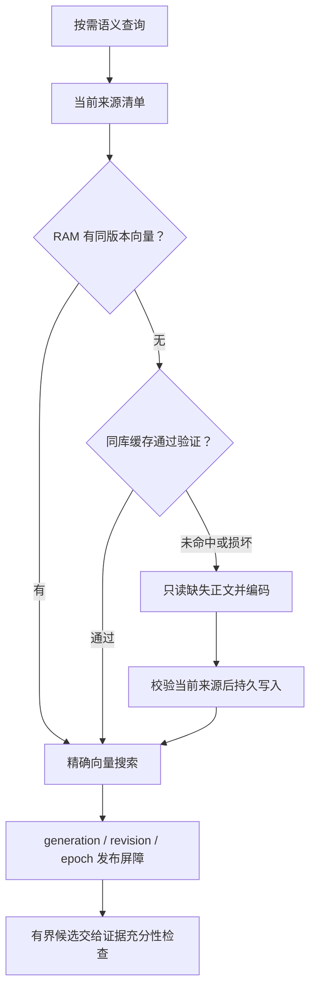

# 同库持久向量投影：重启、撤销与可重建性

本页描述 `memory_vector_cache.py` 和 `SemanticMemoryRetriever.prepare_indexed` 的实际实现。原来的 RAM-only batch64 基准仍保留在 `../evidence/ondemand-memory-20261101/incremental-embedding/`；它揭示了一个实质缺口：10,000 条短中文记忆首次编码约 153 秒，而旧实现每次结束进程都会失去这些向量。持久化用于消除相同版本的重复编码，不改变检索相关性判断，也不把向量当成长期事实权威。

## 权威与投影

唯一长期事实权威仍是角色目录中既有 SQLite 的 `memory_state.payload`。现有 `memory_index_entries` 是可重建规范化投影；新增的 `memory_vector_cache` 和 `memory_vector_cache_meta` 也放在这一个 SQLite 文件内。没有另建向量数据库，也没有向原始 JSON 写入向量或新增模型推断事实。

向量表只保存来源 ID、来源指纹、隔离字段、模型规格、归一化 float32 二进制和校验和。它不另存记忆正文。缓存命中也必须先读取当前权威投影头部，确认来源仍存在且有效。最终进入模型的事实文本仍由检索服务从当前权威来源读取和认证。



这张图描述语义候选准备；不表示普通聊天、准确字段查询也必须调用 embedding。是否需要语义路径由上层路由决定。

## 缓存身份与规格

模型固定为 `BAAI/bge-small-zh-v1.5`，Qdrant ONNX revision `46fbe35fd4374a00fee7de77dfddaeb6dd6a2c59`。实际输出为 **512 维**。当前编码输入为标题、正文和 tags，向量归一化后以 little-endian float32 保存；编码协议标识为 `title-summary-tags:normalized-f32-le:v1`。

模型名称、固定 revision、维度、编码协议共同产生 namespace。每行还绑定 owner、character、scope、memory ID、`evidence_fingerprint()` 和当前 index generation。因此修改模型、量化输出维度、编码字段或归一化规则时，需要变更对应版本，旧缓存不会与新规格混用。

`evidence_fingerprint()` 覆盖事实性 metadata、来源、版本、有效时间、owner/character 和 scope。访问次数和纯审计时间不属于语义修订，不能因一次召回就重新编码。

## 读取顺序与并发

每次缓存读写先进入既有 `memory_index._ready(store, now=...)`。它负责修复 dirty 投影、处理到期事件、检查权威状态是否存在和 owner/character 是否一致。随后缓存操作在同一 SQLite 事务中比较传入的 `(generation, revision, context_epoch)`，按主键读取本批来源头部，检查指纹、范围、有效时间、置信度与撤销状态。

每批最多 512 条；生产路径以 256 条读取缓存或正文，模型内部 passage batch 为 64。缓存命中不读取原始正文，不运行 passage encoder。缓存缺失时只读取缺失来源，完成编码后重新进入事务验证来源，不能把编码期间已撤回的向量写回。

查询准备结束前还要再次检查完整的三元状态。即使缓存读出后、搜索前发生遗忘，旧候选也不能发布。`candidate_ids` 与兼容评分回调再次读取元信息，检索服务还负责最终来源认证。因此缓存读事务不是跨整个模型请求的长期锁，也不是省略最终检验的理由。

来源变化最多重试三轮。仍持续竞争时返回明确失败，由上层处理不可用的语义路径，不能发布旧评分。编码期间仅新增无关来源、或者缓存写入短暂失败时，已编码且仍有效的 RAM 向量进入待持久化集合；下一次有界准备会补写，不为了重试持久化而再次编码。

## 更正、遗忘与到期

缓存建立时在 `memory_index_entries` 上安装两个 SQLite trigger：`memory_vector_cache_invalidate_update` 和 `memory_vector_cache_invalidate_delete`。来源指纹、身份、scope、置信度、有效时间、deleted 或 expired 改变时，触发器在现有来源事务内删除该 ID 的所有模型版本向量；物理移除来源也同样删除。普通访问计数、ordinal 调整、raw digest 更新不触发重编码。

因此更正和遗忘不用等下一次语义查询才能删除持久缓存。未来生效的来源不会提前持久编码；到 `valid_from` 后才进入有效候选。到期处理经过 `_ready` 的既有 TTL 屏障，再清除相关向量。

SQLite projection 重建会改变 generation，且 SQLite 会自动移除绑定在旧来源表上的 trigger。下一次缓存入口先清除旧 generation 的派生行，并重新安装 trigger。缓存表结构或自己的 schema version 不匹配时，只重建这两张派生表；先移除它们自己的 trigger，再重建和安装，避免悬挂引用阻碍正常写入。

这里实现的是应用层撤销、派生行删除和不再召回。SQLite 空闲页、旧备份或用户另行复制的数据库不属于安全擦除保证；不能把逻辑遗忘宣传成磁盘取证不可恢复。

## 缺失、损坏与可选关闭

没有缓存表、缺一行、错误维度、长度不符、校验和不符、NaN/Inf、非单位向量都不会提供证据。坏行会被丢弃，按当前来源重新编码。缓存错误在局部 SAVEPOINT 中回滚，能降级为 RAM 的情况会在 `status` 记录错误；权威数据库本身缺失或无效则继续 fail closed，不能仅凭旧向量恢复事实。

`persistent_cache=False` 可关闭该 retriever 的持久读取和写入，保持 RAM-only indexed 路径。默认开启。原 `prepare(query, entries, ...)` 兼容路径仍保持 RAM 语义，方便旧检索基线对照。

正常清理使用 `MemoryVectorCache.clear(store, now=...)`，删除派生行并保留表和触发器，不修改人格或长期事实。关闭开关不会自动销毁已有缓存；来源后续更正/遗忘仍通过触发器清理这些行。

人工在 SQLite 工具中仅 `DROP memory_vector_cache`、却保留引用它的 trigger，不是支持的清理方式。SQLite 编译 source UPDATE 时会报缺表，即便 trigger 带存在性 WHEN 条件也无效。若人为破坏了这类 schema，应在备份数据库后，先移除这两个 cache trigger 和两张 cache 派生表，再由正常索引入口重建；不要删权威 `memory_state`。本轮未为这一非法手工 DDL 路径把缓存模块耦合进所有权威写入。

## 观测与判错

除了既有编码和查询阶段指标，`status` 现在提供：

| 字段 | 含义与诊断用途 |
| --- | --- |
| `persistent_cache_enabled` | 当前 indexed retriever 是否启用持久投影 |
| `persistent_cache_hits` | 本次 prepare 从 SQLite 恢复的向量数；不能与 RAM 命中混算 |
| `persistent_cache_writes` | 本次通过当前来源校验后写入的行数 |
| `persistent_cache_discarded` | 本次发现的错误或失效缓存行数 |
| `persistent_cache_errors` / `persistent_cache_error` | 缓存降级次数与异常类型；不记录私有正文 |
| `persistent_cache_pending` | 已有有效 RAM 向量但尚待持久写入的数量 |
| `persistent_cache_read_ms` / `persistent_cache_write_ms` | 缓存事务实际耗时 |
| `last_encoded_entries` / `encoded_entries_total` | 实际 passage 编码数量；重启命中时应为零 |

`index_prepare_ms` 加入缓存读写时间，仍包含 manifest、正文读取和 passage 编码。`prepare_ms` 包含完整准备；模型载入、数据库权威更正、LLM 生成需各自单列，不能拿一个向量更新时间代替整次操作。

典型错误包括：相同指纹重启仍编码 N 条；更正后旧 ID 还留在持久行；只新增一条就全量重新编码；修改访问次数使缓存失效；forget 后旧回调仍返回分数；缓存存在但权威丢失时仍发布候选。测试与 profiler 分别覆盖这些现象。

## 测试与复现

`tests/test_persistent_semantic_memory.py` 使用真实 SQLite。计数编码器只验证缓存协议，不能作为语义质量证据。另有真实 pinned BGE 测试，关闭第一 retriever 后启动独立 Python 子进程；该子进程把 passage encoder 设置成“一旦调用就失败”，仍能通过已保存向量完成查询，证明没有用进程内对象冒充重启缓存。

两个开发中的真实 red→green 失败案例已修复：编码期间只新增来源，使第一次持久写因 revision 变化被拒后，初版重试漏存仍有效的旧向量；以及第一次缓存写失败后，初版热查询只复用 RAM、没有补写，重启又会重复编码。现在分别通过待持久化集合解决，测试保留原触发条件。

正式脚本为 `tools/profile_persistent_embeddings.py`：300、3,000、10,000 条同长度分布的六模板中文合成记忆；每规模三个独立进程：首次创建及编码、重启恢复并执行一次更正和一次遗忘、再次重启验证撤销传播。分别保留各子进程 JSON/log，记录完整源文件 hash、模型、环境、实际计数、RSS、SQLite 向量字节数和完整进程耗时。

```bash
OPENBLAS_NUM_THREADS=1 OMP_NUM_THREADS=2 \
python tools/profile_persistent_embeddings.py \
  --source-root /absolute/path/to/E-Moti \
  --model-cache /absolute/path/to/pinned-model-cache \
  --output /absolute/path/to/persistent-embedding-performance.json
```

## 首轮持久化三尺度实测（历史基线）

以下三尺度来自首轮实现，完整原始数据和 source hash 保留。第二轮冻结版本 `1eef5cb` 的新结果在下一节单列，仅复测 10,000 条；300 和 3,000 条没有在第二轮复跑，不能把下表称为当前冻结版本的完整三尺度结果。

聚合结果为 [`persistent-embedding-performance.json`](../evidence/ondemand-memory-20261101/incremental-embedding/persistent-embedding-performance.json)，同目录保留九个子进程的独立 JSON/log。每个规模三个不同 PID，七个相关生产源文件在各阶段和整个规模运行期间的 hash 均一致。所有阶段断言通过：cold 编码 N 条，重启编码 0 条，更正仅编码 1 条，遗忘编码 0 条；再次重启后只恢复 N−1 条仍有效的向量。

| 初始条数 | 首次建索引及编码，不含模型载入 | 重启恢复＋首问，不含模型载入 | 该重启的模型载入＋恢复＋首问 | 更正/遗忘后的再次重启恢复＋首问 | 两次重启 passage 编码数 |
| --- | ---: | ---: | ---: | ---: | ---: |
| 300 | 4.540 秒 | 18.739 ms | 391.175 ms | 19.284 ms | 0 / 0 |
| 3,000 | 42.971 秒 | 110.610 ms | 505.926 ms | 122.898 ms | 0 / 0 |
| 10,000 | 135.702 秒 | 379.413 ms | 800.054 ms | 384.213 ms | 0 / 0 |

再次重启阶段还用禁止 passage encoder 的保护函数验证零编码。其完整子进程耗时为 **657 / 783 / 1,058 ms**，包括 Python 进程启动、导入、服务初始化、模型载入、首次查询、三次热查询和记录结果；不能将这个完整耗时与上表的单一 prepare 阶段混用。10,000 条的第二次恢复中，缓存读取约 266 ms，manifest 及其屏障约 70 ms，矩阵构建与精确搜索约 18 ms；所有细分时间保留在原始 JSON。

| 初始条数 | 重启进程的三问 RAM 热准备 p50 | 更正：权威写入 / 随后语义准备 | 遗忘：权威写入 / 随后语义准备 | 冷编码进程峰值 RSS | 再次重启验证进程峰值 RSS |
| --- | ---: | ---: | ---: | ---: | ---: |
| 300 | 5.696 ms | 127.163 / 15.558 ms | 78.027 / 6.521 ms | 393.90 MiB | 221.65 MiB |
| 3,000 | 11.888 ms | 1,414.326 / 29.893 ms | 844.468 / 21.214 ms | 438.64 MiB | 220.97 MiB |
| 10,000 | 21.812 ms | 4,151.678 / 64.241 ms | 2,503.046 / 55.657 ms | 458.56 MiB | 247.89 MiB |

10,000 条更正仍需要约 **4.15 秒权威 JSON 写入，再加约 64 ms 语义准备**。持久缓存没有消除现有 JSON 权威的全量写入成本，不能宣传成“更正只需 64 ms”。这两类写入各只有一个测量点。热查询每阶段只有三个问题，不是 p95 或生产 SLO。

首次 10,000 条向量的原始 BLOB 总量为 20,480,000 bytes；遗忘后 9,999 条为 20,477,952 bytes，RAM 搜索矩阵另有同量级副本。最终 SQLite 文件为 106,414,080 bytes，包含原始权威 JSON、结构化/FTS 投影、向量表、索引及空闲页，不能把它全部归因于向量本身。数据库中立即可见的持久行在更正写入后降到 N−1、补编码后回到 N、遗忘写入后再次降到 N−1，且下一进程未恢复撤销内容。

环境为 Linux x86_64、Python 3.12.14、SQLite 3.53.1、FastEmbed 0.9.1、NumPy 2.5.4、ONNX Runtime 1.31.1。宿主报告 AMD EPYC 9V74，容器 CPU 配额为 8 核、内存上限 8 GiB；BGE 设置 2 个推理线程，OpenBLAS 1 线程。权重已在本地，`local_files_only=True`，未测首次下载。文本长度中位数为 62 / 63 / 63 字，最大 65 / 66 / 66 字。协调避开重型并发，但没有独占 CPU。

RAM-only 历史基线的 10,000 条首次准备为 152.989 秒，本次首次准备为 135.702 秒；这两次 source hash、存储修订和运行时状态不同，不把差值单独归因于持久化。可明确验证的收益是：同规格、同有效来源跨进程恢复不再编码 N 条，首次编码与重启恢复的成本被实际分开测量。

首轮 focused 日志 [`persistent-semantic-focused.log`](../evidence/ondemand-memory-20261101/incremental-embedding/persistent-semantic-focused.log) 为 **66 passed，0 skipped，2.36 秒**：30 项新增持久缓存测试、25 项既有增量/语义测试、11 项生成入口契约测试。合计包含四项真实 BGE 测试；其余受控编码器或 transport 仅验证协议，不作为模型回答正确性的证据。

## 第二轮冻结版本的 10,000 条复测

源码冻结为 `1eef5cbb6f85703f0350f8708cc86bf84a7e071f`，结构化值算法标识已包含 `structured-value-v1`。在同一固定 BGE、相同六模板语料、batch64 和三个独立进程下，再次运行完整冷建、重启、更正、遗忘及再次重启。结果见 [`round2-10000/README.md`](../evidence/ondemand-memory-20261101/incremental-embedding/round2-10000/README.md)；该目录保留聚合 JSON、三个阶段 JSON/log、运行前计划和完整 hash 审计。

| 当前冻结版本的 10,000 条指标 | 实测值 |
| --- | ---: |
| 冷编码及索引准备，不含模型载入 | 145.897 秒；编码 10,000 条 |
| 独立进程恢复＋首问，不含模型载入 | 385.531 ms；编码 0 条 |
| 该进程模型载入＋恢复＋首问 | 776.065 ms |
| 更正的权威写入 / 随后语义准备 | 3,834.051 / 68.425 ms；仅编码 1 条 |
| 遗忘的权威写入 / 随后语义准备 | 2,720.570 / 49.588 ms；编码 0 条 |
| 再次重启恢复＋首问，不含模型载入 | 370.950 ms；恢复 9,999 条、编码 0 条 |
| 再次重启模型载入＋恢复＋首问 | 738.174 ms |
| 再次重启完整进程耗时 | 1,039.352 ms，含首问、3 问热查询及记录结果 |
| 三问 RAM 热准备中位数，前/后重启进程 | 24.148 / 23.117 ms |
| 冷编码 / 再次重启峰值 RSS | 458.668 / 248.754 MiB |

再次重启进程继续使用禁止 passage 编码的断言，仍成功完成查询。更正与遗忘事务立即删除受影响持久行，新旧被撤销来源没有在第三进程恢复。三个进程的原始首问 top 4 ID 一致；这只证明缓存恢复的检索一致性，不是事实回答正确率。

所有 135 个顶层生产 Python 文件及 profiler 在运行前后 hash 一致，脚本记录的七个核心文件在三个子进程内也一致。持久缓存错误和待写数量均为零。相同模型版本、有效来源与 generation 的重启不会重编码；结构化算法升级导致 generation 改变时仍会按契约重建。本组使用新建数据库，不是旧算法升级耗时测试。第二轮 generation 协议回归另有 **50 passed，2 项真实 BGE 测试未在该组执行**，原始日志见 `storage/structured-fact-values-v1/`。

更正和遗忘依然分别约需 3.90 秒和 2.77 秒，权威 JSON 写成本没有被向量缓存消除。新旧性能各为单次运行，不将时间差解释成第二轮算法的显著提速或退化。第二轮仅追加这一大规模结果，保留首轮两种较小规模为历史证据。全部重型任务已协调错开，但没有独占 CPU。

合成短文本不是长期真实聊天，缓存协议和速度提升也不能代替答案质量、人格行为、Windows 桌面真机或手机设备评测。这些边界由总体评测报告单独列出。此性能脚本的 RSS 采集使用 Linux `resource`，在 Windows 重跑需改用 Windows 的实际进程内存采集器或使用匹配的 Linux 环境，不能直接把本表视作 Windows 实测。
