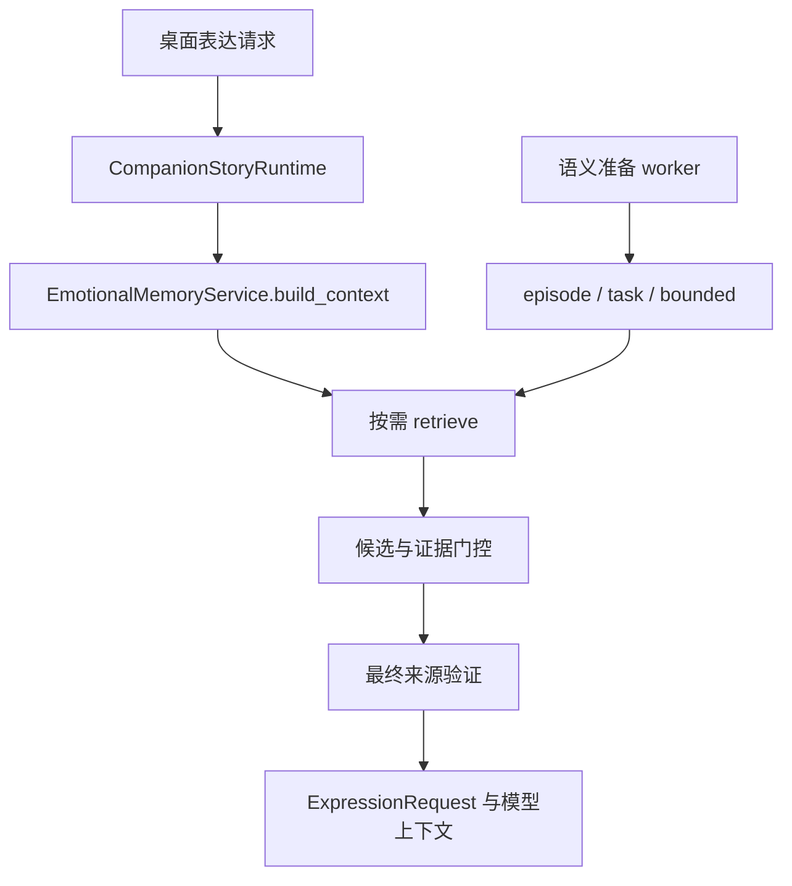
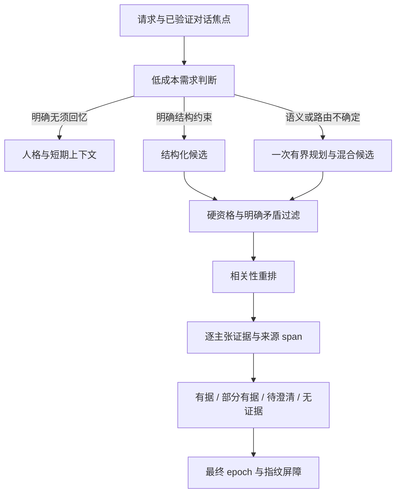

# 按需检索发布审查与下一轮泛化工程

审查对象：生产冻结 `1eef5cbb6f85703f0350f8708cc86bf84a7e071f`，评测工具冻结 `53cb836dc8558fc1498db4c673207db4e7868f14`。本文件是只读源码审查产生的交付判定与后续实施要求，**下面提出的新接口、模式开关、语义判定器和 shadow 路径尚未实现**。当前结果以 [完整评测记录](ondemand-evaluation.md) 为准。

后续兼容修复检查：`b5b43e2a83a392b56d11cd2c24f01a89bdf22364` 只修正一个由既有测试暴露的主体解析优先级问题，见第 7 节。不得把 `1eef5cb` 的首次独立评分重标为该补丁后的未见结果；补丁后的重跑属于回归。

## 1. 发布判定

**当前分支是完成大量工程实现、但未通过开放语言回忆质量验收的候选版本。不能仅凭确定性测试通过和开发集分数，把新检索策略作为经过验证的生产替代方案。** 代码保存在本地工作分支，尚未推送、合并或发布。用户真实存档未参与本轮合成基准。

第二份独立、首次评分的 48 题中，新策略严格正确交付 7/33 个有答案问题，相关证据 delivered recall 为 0.2121；旧词法为 7/33，旧 BGE + RRF 为 6/33、delivered recall 0.6970。新策略对 10 个无答案问题注入 0 次、48 题禁用来源注入 0 次，但路由精确匹配仅 14/48。这说明保护来源与拒绝错误证据的机制有实际价值，同时存在严重误拒；不能将“零未知注入”单独解释为总体质量提升。这些都是这一数据集上的观测，不代表所有输入绝不泄露。

以下工程成果可以独立评价：同库派生索引、有来源的摘要、纠正和遗忘传播、增量向量缓存、最终发送前的版本屏障、数据读取性能。它们不依赖把不合格的开放语言策略宣传为已验收。

## 2. 当前默认行为确实已经改变

默认链路为：



相关源码入口：

| 文件与入口 | 当前行为 | 回归影响 |
| --- | --- | --- |
| [emotional_memory_service.py](../../../src/guanghe_companion/emotional_memory_service.py) `build_context` | 直接调用新的 `retrieve`；旧实现保留为 `build_legacy_context` | 不是独立实验 API，现有桌面调用者会得到新策略 |
| [companion_story_runtime.py](../../../src/guanghe_companion/companion_story_runtime.py) `build_expression_context` | 默认调用上述 `build_context`，传入近期对话 | 自然聊天及回忆能力直接受到新路由影响 |
| [plugin_enabled_controller.py](../../../src/guanghe_companion/plugin_enabled_controller.py) `prepare_semantic_recall` | 调用 `memory.prepare_retrieval` | 不能只恢复旧 `build_context` 而不检查准备阶段，否则得到不完整的旧语义路径 |
| [ondemand_memory.py](../../../src/guanghe_companion/ondemand_memory.py) `prepare_retrieval` / `retrieve` | 只对 episode、task、bounded 准备语义；fact 即使字段未解析也没有语义候选 | 开放属性被分类为 fact 后主要受词法候选与字面证明约束 |
| [retrieval_evidence.py](../../../src/guanghe_companion/retrieval_evidence.py) `check_evidence` | 先检查资格与语言支持，随后才调用 `_rank` | 被语言门控拒绝的候选，BGE 或 RRF 无法挽回 |
| [retrieval_literal.py](../../../src/guanghe_companion/retrieval_literal.py) `literal_field_support` | 未识别字段要求剩余对象字面片段全部被来源覆盖 | 对象消歧有用，但不能普遍证明自然语言改写是否等价 |

当前没有面向桌面的已实现 `compatibility / experimental / shadow` 选择器。文档中的实验定位是发布判定，不是一个已经存在的软件开关。

## 3. 过度拒绝来自哪些通用机制

### 3.1 把“明确不匹配”与“没有解析出来”合并为否定

owner、角色、scope、删除状态、有效时间属于可判定的资格约束。明确知道问题问的是甲、记录属于乙时，拒绝正确。问题中的属性或指代尚未识别时，得到的是未知解析结果，不能自动证明候选无关。

当前 `EvidenceDecision.accepted` 只有布尔值，`field_mismatch_or_unproved` 等 reason 把确定矛盾与无法证明合在一起。后续扩展仍重复同一门控，因此多读候选也难恢复被语言理解限制挡住的真答案。

### 3.2 语义检索只参与排序，不能解决语义判定

当前顺序是候选 → `check_evidence` → accepted 集合 → `_rank`。这保护了硬约束，却也让词法门控成为 BGE 的最终能力上限。增加候选数、RRF 权重或降低 cosine 阈值不能解决这个结构问题；同时，直接让 cosine 越过资格与冲突约束也会重新引入近似但错误的主体、字段和事件。

### 3.3 路由规则承担了过多语言理解职责

当前路由同时承担普通聊天识别、复杂句切分、事实字段映射、事件/任务分类、时间解析和多轮指代。关键词与标点规则适合作为低成本快路径，但不适合作为所有句型的最终裁判。错误的 route 还会改变 scope、是否准备语义、字段约束和充分性检查，造成级联漏召回。

多轮逻辑重新解析近期用户句子并拼接查询，尚不是持续维护的、可撤销来源支持的实体与事件焦点。不能靠继续列举更多代词或任务动词解决整个问题。

### 3.4 “unknown”不总等于已经查明没有记录

一次有界检索没有通过门控，可能是确实没有证据，也可能是属性未解析、候选尚未覆盖、时间基准不匹配或判定器不支持该表达。对用户都说“没有可靠记录”会造成它明明记过却不记得的体验。API 应保留原因；产品可以选择澄清或说明暂时没能确认，而不是断言从未发生。

## 4. 下一阶段的目标架构

保留一个长期事实权威和当前来源撤销机制。**资格过滤继续硬性执行；语言不确定性进入一个有预算、可评测的语义判断路径。** 不再通过不断增加特定题型正则使开发集变好。



这里的语义判断可以是本地交叉编码器与规则的组合，也可以复用已有 LLM 提供一次结构化批量判定；选择取决于真实中文改写测试、模型可用性和时延。没有证据表明仅接入任一模型就会自动合格，必须保留当前五组比较并加入新方法。

### 工作包 A：将资格、解析与支持状态分离

Codex 扩展现有契约，避免在新的数据库中重复保存事实。建议接口如下，字段名是待评审设计，不能视为当前可调用 API：

```python
EligibilityResult(
    eligible: bool,
    hard_reasons: tuple[str, ...],
    checked_epoch: int,
    source_fingerprint: str,
)

ConstraintBinding(
    value: str | None,
    state: Literal["explicit", "source_resolved", "unresolved", "conflicting"],
    source_ids: tuple[str, ...],
)

SupportDecision(
    relevance: Literal["irrelevant", "relevant", "uncertain"],
    support: Literal["supported", "partial", "contradicted", "unknown"],
    supported_claims: tuple[ClaimEvidence, ...],
    missing_claims: tuple[str, ...],
    verification_method: str,
    verifier_version: str,
)
```

`ClaimEvidence` 必须绑定记忆 ID、来源版本、实际文本片段位置和该片段支持的主张。模型可以解释问题与证据之间的关系，但不能把生成的答案字符串保存为新的用户事实。原始来源不存在或 span 越界时，不赋予 `supported`。

验收：明确错主体、错字段、计划冒充已发生、当前/历史错位、撤销和跨角色案例保持拒绝；未解析字段与明确错误字段得到不同状态；同一失败原因不能既当“无记录”又当“肯定无关”。

### 工作包 B：开放属性候选与相关性重排

`unresolved_field` 仍限定 owner、角色、授权 scope 与有效时间，但允许使用当前持久化向量索引补充候选。明确的主体不能被语义近邻替换；字段未知时不伪造字段约束。结构化与混合候选共享现有 64 条预算，避免两套预算各自膨胀。

相关性排序输出的是排序信号，不是事实正确概率。候选中的明确矛盾先拒绝；剩余候选再进入字段解析或证据判定。离散对象限定词不依靠总体相似分数吞掉，例如不同设备、不同人、不同时间仍必须按原始来源核实。

验收：分别测 candidate recall、资格过滤后 recall、支持判定后 recall、最终 Prompt delivered recall。所有前后变化可归因，不能只报告最终一个 Recall@K；保存正确证据在哪一阶段消失。

### 工作包 C：有界复杂路由与连续对话焦点

保留明确问候、无回忆要求和精确结构查询的零额外模型快路径。其他请求先产生带不确定性的 plan；仅在不确定、混合或指代未解决时调用一次有预算的规划器。规划器只可选择允许的路由与约束，不可扩大访问权限或把外部实时状态改成长期记忆。

维护有界对话焦点：当前实体、事件、字段、时间窗口、来源 ID/指纹、最近使用 turn 与失效条件。焦点是可重建短期状态，来源撤销或角色切换后清除；助手自行生成的名称不能成为可信实体绑定。复杂句切分应保留条件、否定及解释范围，不能仅按逗号视为多个独立请求。

若规划器不可用，执行一次有界候选读取或请求必要澄清；不声称“全库查无记录”。作用域不明时沿用当前授权范围，不以提高召回为由查询所有场景。

验收：零额外调用的普通聊天比例、复杂请求调用率、规划延迟、混合意图覆盖、多轮焦点精度、错误继承率、撤销后焦点泄露均单独计数。

### 工作包 D：校准后的证据充分性

第一版语义判定器只对重排后至多 8 条候选一次批量处理，沿用一次扩展和全局 Token/字符预算。输出逐主张支持/缺失/矛盾与原文证据，程序再次验证来源片段和版本。缓存键包含查询及对话焦点、来源指纹、模型版本、判定器版本和 context epoch；任何一个改变就不能复用旧结论。

不要直接采用一个未经校准的 cosine 常数作为答案门槛。使用独立开发/校准集分析各查询类别的支持精度、召回、拒绝率和置信曲线。若采用概率标定，报告标定方式、样本量与误差；数据不足的类别不输出虚假的百分比。至少区分自动交付、仍需验证/澄清、拒绝三种行动。

阈值选择应同时计算误交付与误拒的代价，并进行敏感性分析。硬性撤销与隔离要求不参与权衡；不能为了召回放行已删来源。数值阈值只用开发/校准数据选择，冻结后再跑独立测试。

验收：有答案覆盖和无答案误注入必须同时达标。对需要多个证据的问题报告完整支持、部分支持和缺失来源；“有一个相关记录”不足以声称整题 `sufficient`。自然表达未知、是否解释部分答案和是否虚构亲密关系，需要真实生成模型和人工行为评审。

### 工作包 E：可控集成与发布门槛

候选策略的集成开关应同时控制准备、执行、Prompt 契约和日志，不能只切换 `build_context`。建议分离以下模式：

| 模式 | 对用户输出 | 条件与代价 |
| --- | --- | --- |
| 已知兼容路径 | 维持已知版本的检索行为，并保留本轮来源/撤销修复 | 旧 BGE 仍有无答案误注入；不能称为质量合格或为此撤回遗忘保护 |
| 显式实验路径 | 使用新路由与支持判定，保留状态解释 | 只用于有意选择的验证；质量失败必须可复现和退出 |
| Shadow | 用户响应只来自已选生产路径；实验结果仅记录差异 | 增加计算成本；必须具备真正只读的验证方式、独立预算与可关闭日志 |
| 分批启用 | 仅对已通过对应评测的明确场景启用 | 需要按场景版本化验收；不能把未解析场景默认当正确 |

**当前 `finalize_indexed_recall` 会在事务内更新访问记录。直接调用两次 `retrieve` 再丢弃一次结果，不是真正 shadow。** 需要新增只读认证/最终验证入口或使用隔离快照，避免实验改变访问次数、后续排序、维护策略及写入延迟。外部 reader 只能读状态，不重复触发执行动作。Shadow 日志保存证据 ID、版本和必要诊断，默认避免无限保存用户原文。

本轮交付首先采取“候选版本、未发布、质量验收失败”的明确标识；实现上述开关本身仍需集成测试，不能在冻结评测后悄悄改默认却继续引用冻结结果。

## 5. 新一轮数据与评测协议

第二份独立测试第一次评分结果必须永久保留。今后它可以用于回归，但已经不再是未见测试。下一轮不以添加这些题的词表为修复方法，不通过改 gold 或删难例取得成功。

建议新增至少 200–400 个经独立作者及另一位审核者确认的测试问题，按故事、实体、应用、属性和表达族划分；数量是计划目标，不是已完成数据。开发/校准/密封集之间不得共享同一故事改写。优先包含真实用户愿意提供并已去标识的交互轨迹，再补语义相近难负例；不能用同一模型同时独立产生全部题目与最终裁判。

每条数据明确：访问范围、主体/对象、原始来源、当前/历史/计划、精确支持 span、期望答案、可接受部分答案、禁用来源、时间基准以及是否需要实时接口。对自然语言与 metadata 的矛盾先单独审理，不把无效样本归功于算法。审理结果可以另列，但保留原始完整分母及原始评分。

保持相同原始语料、预算和固定模型版本的五组对照，增加候选新策略。除已有指标，再报告以下配对变化：

- 旧方法正确、新方法也正确；新增正确；丢失原有正确；两者均错误。
- 无答案精度与有答案覆盖的联合曲线，分 query 类别与语义改写强度。
- 路由错误、候选缺失、硬资格排除、相关性误判、支持误判、预算裁剪、最终版本变化七类损失。
- 不必要检索与额外模型调用，不把“少调用但不回答”当无条件收益。
- 真实生成答案的事实正确性、恰当未知、部分回答、来源忠实度、人格稳定和不必要提旧事。

按故事聚类做置信区间和 bootstrap，不能把同一事实的多个改写当完全独立样本。发布门槛应预先登记：硬撤销/隔离测试全通过；有答案覆盖不能明显低于基线；严格正确率与未知注入联合优于基线；真实模型行为和桌面交互达到产品门槛。具体容忍差值应在观察新密封结果前写入评测配置；不能先看测试分数再选择一个刚好通过的门槛。

## 6. Claude 与 Codex 的衔接

Codex 负责契约、资格分解、向量候选、语义判定器、缓存版本、可控模式、真实只读 shadow 和逐阶段评测。所有输出继续绑定现有来源体系，不重建事实权威。

Claude 负责区分“没找到”“没理解指代”“只证实一部分”“实时接口暂不可用”的呈现与追问；对正确记忆也不强行展示回忆；观察纠正后是否自然承认更新、遗忘后是否停止暗示旧事，以及角色是否维持稳定表达习惯。Claude 可以标注行为偏差，但不能通过改变 Prompt 要求模型忽略未知状态来掩盖后端缺口。

双方共同验收真实模型回放和桌面交互。单元测试、SQLite/BGE 实测、最终 Prompt 证据交付、模型回答和长期人格体验五层证据分别记录。发布候选成为默认能力之前，必须有跨这五层的证据链，不能从其中一层直接推断其他层已经完成。

## 7. 既有更正/重启回归与最小兼容修复

冻结版本的全量测试发现 `test_teacher_correction_preserves_relation_after_restart` 的 8 个既有参数组合失败。数据已经正确保存与纠正，但请求“我学吉他的老师叫什么？”未交付正确的新姓名。这是原有用户路径的兼容回归，不是从新密封集提取题型后增加规则。

只读函数探针定位到同一处优先级冲突：`_fact_constraints` 已得到 `relation:吉他老师 + name`，随后 `_literal_subject` 中较粗的所有格前缀捕获把主体替换为 `relation:学吉他`。同一机制也会把“同事的助理”缩成“同事”，把“朋友的室友”缩成“朋友”。

补丁 `b5b43e2` 只修改 [retrieval_router.py](../../../src/guanghe_companion/retrieval_router.py) 的该优先级及 [test_router_generalization.py](../../../tests/test_router_generalization.py) 中 6 条公开 plan 断言：

- 已有字段语法解析出的具体非 self 主体，优先于较粗所有格提示。
- 对“某人租的仓库 / 买的设备”等已有所有权动作语法，仍选择真正的所有者。实现只是给原有动作正则加捕获名，**没有增加实体、职业、应用或新动词词表**。
- 原有代词、宠物及本人识别分支保持原顺序；字段判断、语义门控、候选和模型配置均未改。
- 新断言在修复前为 4 失败、2 通过；它们覆盖活动修饰、嵌套人物关系和所有物对照。原有重启更正闭环、错误人物不得覆盖、嵌套别名遗忘后不得回退仍须进入完整回归。

本审查检查了该提交的两文件 diff，修复边界符合最小语法优先级调整，没有读取密封题目来设计修复。最终测试与质量重跑结果由统一评测文档记录。**即使这项兼容修复通过全部确定性测试，也不表示第 3 节的语义泛化问题已经解决，更不改变本文件的发布阻断判定。**
