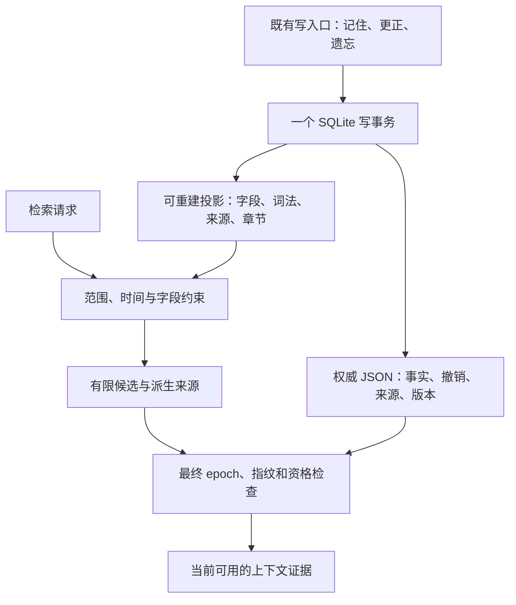

# SQLite 索引、迁移与生命周期契约

本页描述已实现的存储层。权威存档继续使用 `memory_state.payload` 的 schema 2 JSON 文档；结构化字段、来源关系、章节索引和词法索引都是同一 SQLite 文件中的可重建投影。首发投影版本 `memory_index_meta.version=1` 与权威 schema 分开；额外的 `algorithm_version` 标识字面事实解析、值表示、中文 token 和 FTS rowid 规则，规则改变时也会重建，不需要把存档升级成另一套事实数据库。当前字面解析标识为 `typed-literal-v4`，值投影仍为 `structured-value-v1`；v3恢复旧明确卡片，v4补足可信旧宠物名称读取。真实旧索引重建时，权威正文、来源和epoch保持不变，见 [升级记录](legacy-card-contract-fix.md)。第9节及9.1节保留包内v2时代的三尺度历史结果，当前Windows成本见 [存储复测](storage-performance-windows.md)，各版本证据分别保存。

实现位置：`src/guanghe_companion/memory_document.py`、`memory_index_schema.py`、`memory_index.py`，以及 `EmotionalMemoryStore` 的新增包装接口。检索充分性、人格提示词和模型回答由上层负责，索引命中不能自动证明某个回答正确。

## 1. 为什么保留 JSON 权威

原有撤销栅栏、纠正链、待确认候选、画像证据、章节依赖及旧存档修复已经共享一个事务。直接把所有状态拆成多套可写表，会同时改变这些生命周期规则和既有调用者的兼容语义。本轮先解决高频读取每次解析全库的问题，在现有写入口提交时同步投影。

正常索引读取只解析选中的 K 条记录，以及当前画像和选中章节确实需要的来源。它不调用 `load_memories()`、不解析权威 JSON 的整个 `entries` 数组，也不逐条运行 `EmotionalMemoryEntry.from_dict()`。首次建索引、投影损坏后的重建，以及实际到期首次触发派生失效，仍会读取完整权威文档。语义写入也继续具有 O(N) 的完整文档成本，不能把“读取变快”描述成所有操作都已经 O(1)。

投影维护为每个原始 JSON 行保留可重建的 `raw_digest`。未改变的行复用之前已验证的投影，只处理 ordinal 或到期状态的变化；正文/metadata 真正改变的行才重新规范化、计算语义指纹及更新词法数据。全局 retired IDs 和 expired revisions 仍独立核查。这个 digest 只是减少重复计算的缓存键，不代替来源指纹，不形成另一套事实权威；访问次数变化也不会强迫向量重新编码。



图中最终检查使用与权威写入同事务维护的当前投影和 `context_epoch`；记录访问次数时，JSON1 按记录的原始数组位置更新权威 JSON。它不是第二个事实写入口。

## 2. 表与权威关系

| 表 | 保存内容 | 能否单独成为事实权威 |
| --- | --- | --- |
| `memory_state` | 现有 schema 2 完整状态，包括 tombstone、纠正来源链和派生证据 | 是，唯一权威 |
| `memory_index_meta` | 投影版本、generation、revision、epoch、小型画像、下一次到期时间 | 否 |
| `memory_index_entries` | 每个规范化 ID 的当前有效所有权行、检索字段、原始 ordinal、正文投影、指纹 | 否 |
| `memory_index_aliases` | 已有显式别名与支持该别名的记忆 ID | 否 |
| `memory_index_sources` | 记忆与来源 ID 的可查询关系 | 否 |
| `memory_index_chapters` | 章节概览及其原有指纹证据 | 否 |
| `memory_index_chapter_sources` | 章节与来源记忆的关系 | 否 |
| `memory_index_fts` | 中文片段和词项的全文索引 | 否 |
| `memory_index_changes` | revision、记忆 ID、指纹、scope、移除标志；不保存正文 | 否 |

`entries` 投影包含 owner、character、scope、kind、subject、entity ID、predicate、fact slot、fact domain、fact value、有效起止时间、事件时间、记录时间、版本、置信度、撤销状态和 supersedes。记录时间使用现有记录的 `created_at`；本轮没有把无法验证的自然语言日期另行变成事实时间。

主体和字段优先来自已有结构化 metadata。可信旧记录可以复用既有保守字面事实解析器生成查询视图；该视图只参与索引，不修改正文。没有事实主体的自我事实用 `user:self`，人物关系保留 `relation:牙医` 一类明确关系标签。任务经验的应用、版本、前提及结果继续保存在原 metadata 中，现阶段可在有限候选上校验，不虚构统一的外部任务权威。

### 2.1 有界结构化事实值

第二轮源码审查确认，原 `_sanitize_metadata()` 会静默丢弃 object 类型的 `fact_value`，而索引的字符串视图会把合法的 `0` 和 `false` 变成空值。现在仅为明确的 `metadata.fact_value` 支持嵌套 JSON object/array；其他 metadata 字段的原有类型、过滤和截断规则保持不变，也没有扩大 `companion` 或 `task_experience` 的范围权限。

新结构化值最多四层容器、每个容器 32 个成员、总计 128 个值/容器节点、序列化后 16 KiB UTF-8 JSON。对象键必须是 1–80 字符的原样字符串，字符串叶子最多 1024 字符，数字必须有限。超限或包含 set、非字符串键等不支持内容，整次写入报 `ValueError` 并保持原状态；不能删除几个成员后把残缺结构当成原事实。规范化会复制嵌套数据，后续修改调用者的原 dict/list 不会悄悄改变已经保存的记忆。

旧标量和扁平标量列表继续使用历史契约，包括原有字符串长度和列表前 16 项规则，避免把合法旧存档变成不可读；上述新预算只作用于新支持的 object 和嵌套数组。权威 payload 保留数值、布尔值及嵌套类型。索引 `fact_value` TEXT 为非字符串值使用稳定、排序、紧凑的 JSON 表示，例如 `0`、`false`、`{"a":1,"b":2}`；原字符串不加 JSON 引号。词法索引包含这个字面视图，不推断结构之外的事实。

来源指纹已覆盖完整 metadata，并对对象键排序，因此仅改变插入顺序不会制造修订，改变任一嵌套叶子会改变指纹。更正、派生信息失效、最终提交、manifest 增量和遗忘沿用同一生命周期事务；没有为结构化值另建事实权威。`tests/test_structured_fact_values.py` 使用通用设备配置验证读写、类型、边界、指纹、纠正、遗忘、FTS 和旧算法重建，未使用评测留出集的特定字段作为测试模板。

服务层 `correct()` 同步补齐了类型契约。明确的调用者提供完整的 slot/domain/value，复用同一 sanitizer；新类型的所有标量叶子都必须被最终保存的 240 字正文逐项支持，否则整个更正拒绝。字符串可由原文或 JSON 转义字面表示支持；数字和 true/false/null 使用完整字面边界，7 不能由 17 或 M10 证明，false 不能由 falsehood 证明。这里只验证字面来源，字段含义仍由明确调用者提供，不能把它宣传成任意自然语言的完整语义蕴含判断。旧字符串更正规则保持原样。检索层复用这一相同支持函数，避免合法保存的 JSON 转义路径随后被读路径当成无来源值。

口头遗忘的值匹配只对字符串执行 substring/startswith，避免 dict/list/非零数字触发 TypeError；结构化值仍可按既有字段、正文或相册 ID 定位。对无关遗忘请求保留原事实，对唯一当前记录的“忘掉这条”沿用原语义。旧结构修复再次运行时也保留已经有完整字面证据的新类型纠正，不能把它们误当旧 parser 损坏结果清掉。`tests/test_structured_fact_corrections.py` 覆盖公共服务记住→更正→旧正文失效→派生失效→口头遗忘，以及无关事实保留、正文截断与数值近似难负例。

## 3. 原子更新与旧存档兼容

`memory_document()` 仍使用 `BEGIN IMMEDIATE`、busy timeout 和 `synchronous=FULL`。在同一个事务里更新权威 JSON、同步投影、清理 dirty 标志，再提交。任一步出错，全部回滚；索引失败不会留下“正文已经忘记、旧索引仍可检索”的半次提交。SQLite 的原子提交语义参见[官方说明](https://www.sqlite.org/atomiccommit.html)。实际突然断电、坏盘和特定 Windows 文件系统故障未在本环境做设备级验证。

三个 SQLite trigger 监听 `memory_state` 的 INSERT、UPDATE 和 DELETE，标记投影 dirty。这样旧版本程序或维护脚本直接更新权威行后，新读取路径也不会继续信任旧投影。下一次索引读取先修复投影，再提供候选。普通文档入口也在把可变文档交给调用者之前处理既有 dirty，防止旧 `expected_epoch` 在修复前继续通过写入检查。该机制处理通过 SQLite 的正常写入，不宣称抵御一个能够删除 trigger、伪造投影和任意修改数据库文件的恶意管理员。

旧 writer 如果没有主动推进 epoch，投影同步会检查已经存在的来源：正文/事实 metadata 指纹改变、scope 改变、撤销、到期标记变化或物理移除，都会补上同一事务内的权威 epoch 屏障。实现使用 JSON1 更新 canonical `context_epoch`，同时修改当前事务的 document 和投影 header，避免第二次 Python 全量序列化；epoch 不允许退回。正常新增事实、访问计数、纯章节或画像变更不因此重置上下文；已正确推进 epoch 的纠正/遗忘/到期不重复推进。

这不仅用于检索。审查中真实复现过：旧 writer 删除来源但不改 epoch，已经生成中的回复仍能通过 controller 校验，随后存入同 epoch 的对话历史。现在既有 controller 的在途结果校验和历史筛选可以观察到修复后的 epoch，拒绝该回复，并保留用户可读的历史档案而不再把旧事实送入推理。测试与实际失败输出见 [`raw-writer-revocation.md`](../evidence/ondemand-memory-20261101/storage/raw-writer-revocation.md)。

迁移保留以下边界：

1. 原三个 JSON 文件仍然只是首次迁移输入。已有初始化 receipt 而数据库缺失，必须报错，不能重新导入旧 JSON。
2. 权威表、权威行、数据库本身损坏或丢失，索引读取失败；不能把投影或旧 JSON 当替代权威。
3. 投影缺表或版本不匹配时，只从当前 SQLite 权威文档重建。新的 generation 会让语义缓存丢弃旧游标和旧向量关联。
4. 原 `schema_version=2`、`PRAGMA user_version=2`、角色目录、owner 子目录和既有 UI 读取 API 都保留。
5. 同 ID 的历史异常重复行仍按“最后一个可解析、属于本 owner 和角色的行”确定当前内容；先解决这一规则，再过滤 scope 和 TTL，避免复活更早的有效副本。
6. `finalize_indexed_recall()` 只更新选中行，保留不相关原始行及未知扩展字段。没有把一次召回变成全库格式清洗。

旧标量事实存档回退到支持 schema 2 的旧应用代码不需要还原事实数据。旧写入口会触发 dirty 标记，之后再次启用本轮代码即可重建投影。**新增 object/嵌套数组事实值后不能让不支持该契约的旧版本重写存档**：旧 sanitizer 会丢掉这些值，即使它仍能打开 schema 2 文件。降级前应保留当前权威文件，使用理解结构化值的只读导出或明确的兼容迁移，不能声称仅回退应用代码就完整支持新类型。也不要恢复一份遗忘前的数据库，那会回退真正的撤销状态。

## 4. 读取 API 和预算

```python
from guanghe_companion.memory_index import IndexedMemoryQuery

snapshot = store.read_indexed_snapshot(
    IndexedMemoryQuery(
        subjects=("relation:牙医",),
        predicates=("name",),
        scopes=("companion",),
        limit=16,
    ),
    now=now,
    include_chapters=True,
    chapter_limit=8,
)

committed = store.finalize_indexed_recall(
    snapshot.entries,
    expected_epoch=snapshot.context_epoch,
    now=now,
)
# None 表示版本竞争，必须重读；() 表示合法的零结果。
```

`IndexedMemoryQuery` 支持 scopes、subjects、predicates、kinds、词法 query、memory IDs、limit、history，以及事件发生时间范围。同类字段内为 OR，不同类别之间为 AND。scope 默认只有 `companion`；跨场景查询必须显式指定相应 scopes。没有 scope 条目时不会放宽为全库。

`memory_ids=None` 表示按其他条件选择候选；`memory_ids=()` 明确表示不读候选。后者适合只读小型画像、epoch 和诊断信息。`include_profile_sources=False` 与 `include_chapters=False` 适合 embedding 按 ID 载入正文，不隐式读取画像的所有来源。

| 返回字段 | 精确定义 |
| --- | --- |
| `entries` | 满足资格、显式字段和词法条件，经过 LIMIT 的候选记录 |
| `candidate_ids` | 与 `entries` 顺序对应的 ID |
| `total_candidates` | SQL 资格、字段和词法条件满足后，LIMIT 之前的完整数量 |
| `rows_loaded` | 本次解码为 entry 的唯一行数，包括候选及实际需要的有效派生来源 |
| `source_entries` | 画像和章节引用的、当前 scope 与 TTL 合法的有限来源记录 |
| `source_eligibility` | 来源当前是否允许使用及理由：valid、missing、revoked、scope、future、expired 等 |
| `context_epoch` | 生命周期失效屏障，不等同于所有新增事实的序号 |
| `index_generation` / `index_revision` | 重建世代和投影变更游标，供增量索引绑定 |
| `timings` | prepare、SQL 资格筛选、候选读取、派生来源读取及总读取耗时 |

当前候选上限为 512，默认 64；章节上限 32，默认 8；派生来源预算为 512。超预算来源被明确标为 `source_budget`，不能认证相关主张。章节先按候选来源关联排序，再补近期概览，所以较早的相关章节不会仅因“不是最新八条”被排除。

资格合法和来源指纹匹配是两件事。`source_eligibility` 表明当前来源可用，上层还必须逐项比对章节/画像保存的预期指纹。一个来源当前存在，不代表旧摘要仍然描述它的当前版本。

## 5. 别名和多跳读取

`resolve_subjects(subjects, now=..., scopes=...)` 返回每个输入到零个、一个或多个规范主体的映射。绑定只能来自当前合法记录中的显式 alias，或可信姓名字段的字面值；同名歧义完整返回，上层不得随意挑选一个人。

例如姓名记录明确说明“用户的陶艺老师叫伍言”，同主体的职业记录可以被“伍言做什么工作”找到。这里依赖的是可撤销的姓名绑定和相同 subject，不能把两条语义相近的人物记录直接拼接。姓名来源被遗忘后，伍言这个名字到该主体的映射立即失效，职业记录本身仍按原规则保留。

需要形成答案的调用者使用 `resolve_subject_bindings()`：它返回 `SubjectResolution`，包含 mapping、准确的来源 ID 和指纹、sources_by_input，以及 epoch/revision/generation。解析后按这些 ID 读取绑定来源，和答案来源一起验证。最终把绑定来源传入 `finalize_indexed_recall(..., dependency_entries=...)`；依赖会重新检查有效期和指纹，但不增加访问次数，也不重复计为回答中的记忆。

解析与随后读取是两个事务。调用者保留开始时的 generation/revision/epoch，在各步核对同一版本；最终再校验绑定指纹。旧维护脚本改变姓名但没有推进 epoch 时，底层会补上 epoch；调用者即使手动提供新的 epoch，旧姓名绑定的指纹仍不能通过最终检查，因此不能仅靠不变的职业记录回答“这个人做什么工作”。`current_index_state()` 提供只读头部的 `(generation, revision, context_epoch)` 屏障。便捷的 `resolve_subjects()` 仅返回 mapping，适合选择界面；用于形成多跳答案时必须使用完整证据契约。

## 6. 中文词法搜索为何没有直接使用裸 FTS5

SQLite `unicode61` 按连续字符类别生成 token，不会自动完成中文领域分词；trigram 对小于三个字符的全文查询有已知限制。本实现先将中文二元片段和单字、英文/数字词项转成安全 token，再交给 FTS5 unicode61 与 BM25。多字中文查询使用 bigram，单字查询使用已索引的 unigram；用户输入不直接作为 MATCH 语法，因此引号、OR、冒号或星号不会改变 SQL 查询含义。[SQLite FTS5 文档](https://www.sqlite.org/fts5.html)描述了 tokenizer、MATCH 和 BM25 的具体语义。

BM25 只提供词法排名。它不能证明“牙医”和“吉他老师”是同一人，也不能证明某段摘要支持一个问题的答案。明确主体/字段优先使用结构化约束；共同经历候选仍须通过上层相关性和证据充分性检查。

构建不含 FTS5 的 SQLite 会使用明确标记为 `token_scan` 的兼容路径；诊断字段 `lexical_backend` 会反映实际后端。此路径没有 BM25 与 FTS 的性能承诺。JSON1 是快速 finalize 的需求；官方说明其函数默认自 SQLite 3.38 起编译，但仍允许构建时省略。当前环境实际验证了 SQLite 3.53.1、FTS5 与 JSON1，Windows 发布包的构建仍应单独探测这些能力。

本轮实测发现并修正一个性能问题：对 FTS 的 UNINDEXED `memory_id` 逐条 DELETE 会使冷建索引退化。现在 FTS rowid 与 entry rowid 一致，新增只 INSERT，更新和撤销按整数 rowid 定位。对应回归测试检查修订后 rowid 的关联和撤销后词法索引移除，避免只增加了表却仍然全表扫描维护。

## 7. 最终提交、历史与遗忘

`finalize_indexed_recall()` 在一个短事务内重新检查 owner、角色、scope、有效时间、删除状态、epoch 和每条内容指纹。任何一项失配都返回 `None`，且不会增加部分记录的访问次数。全部合法后才更新访问次数和最后访问时间。

JSON1 使用数组 ordinal 替换选中的 canonical 行；指纹没有把访问次数当内容版本，因此正常阅读不会反复触发 embedding 编码。JSON1 减少 Python 全量解码，但底层仍处理完整 JSON 文本，不能宣传成 O(1) 文档更新。[官方 JSON1 文档](https://www.sqlite.org/json1.html)也明确区分文本 JSON、JSONB 及其性能边界。

历史查询的含义是：已经开始有效但 TTL 已结束的记录，在 `history=True` 时可以作为明确的历史证据；最终提交还需显式 `allow_history=True`。未来尚未生效的记录、被显式遗忘/撤销的记录、被纠正链退休的旧正文都不会因此重新出现。本轮没有新增一个可绕过遗忘的“历史原文恢复接口”。精确 as-of 多区间查询和历史别名关系属于后续扩展。

到期第一次发生时，沿用现有 `_expire_document()`：使相关画像和章节失效，推进 epoch，记录该内容指纹已经处理过。后续查询只比较索引中的 next expiry，不会每句聊天重做全库到期检查。显式遗忘还会移除别名和 FTS 项，并在 manifest 产生移除通知。

“遗忘”在现有产品契约中是不可再次用于上下文的逻辑撤销。原有权威文档保留退休记录以维护纠正链与防重放，本轮没有声称安全擦除磁盘、旧备份或导出文件。用户若要求物理清除，需要另行设计备份轮换、SQLite 清理、审计和撤销栅栏的保留策略。

## 8. 增量 embedding 的读取契约

`index_manifest(now, scopes=..., after_revision=..., limit=2048, after_id="")` 只读取 ID、指纹、scope、版本和时间等列，不 SELECT 正文。`records` 提供当前版本，`removed_ids` 包含撤销、到期、scope 移出和没有当前行的删除 tombstone。

正确的消费者流程是：

1. 首次读取完整 manifest，并保留 generation、revision、每条指纹和有效时间。
2. 按 `next_after_id` 分页；同一批每页保持相同 after_revision。若各页 generation/revision 变化，重试，不能拼接跨代快照。
3. 后续读取增量；先应用 `removed_ids`，再为真正改变或新增的合法内容按 ID 读取正文和编码。
4. generation 改变时清除旧派生关联，从完整 manifest 重建；不能把新库较小的 revision 当成“没有变化”。
5. 对 `valid_from` 在未来的记录保留时间元数据。它当前 eligible=False，但 removed=False；日后生效没有凭空改变内容指纹，消费者必须据时间重新判断资格。
6. 编码在 SQLite 事务外执行。发布评分前核对 generation/revision/epoch，最终上下文仍走 finalize 的指纹验证。

访问次数变化不增加语义 revision。当前变更日志没有定时压缩；它只保留标识和指纹，不保留正文。规模和磁盘增长达到实测阈值后，可以增加保留窗口与“游标太旧必须完整同步”的协议；不能静默丢弃增量事件。

## 9. 验证与性能记录

新增确定性测试覆盖结构化硬约束、角色/owner/scope 隔离、TTL、同 ID 异常行、元信息读取、派生来源资格、别名跨字段与歧义、纠正/遗忘、manifest 分页与 tombstone、回滚、原始 SQL dirty、缺库/坏库禁止旧 JSON 回源、索引重建和 JSON1 最终指纹检查。测试入口为 `tests/test_indexed_memory_store.py`。

最终补上 `tests/test_raw_writer_revocation.py` 的 24 个确定性回归，包含真实 SQLite 与 controller 的在途旧回复、已写入对话历史、普通新增不重置、正常纠正/到期不双增、纯章节不重置和原子回滚。该文件与现有 storage/context/lifecycle/adversarial/maintenance/emotional 测试一起实际执行为 **162 passed in 4.67s**；JUnit 记录位于上述证据目录。这里的回复是用于检验投递屏障的确定性事件，不能称为实际 LLM 生成质量评测。

`tools/benchmark_memory_index.py` 使用真实临时 SQLite，并通过不同 `PYTHONPATH` 分别载入本轮前置版本和本轮版本。语料、四条证据 ID、输入长度和样本分母相同；报告热读取、热 finalize、二者组合、结构化查找、词法搜索、空查找、manifest、冷重建、更正、遗忘、Python 分配峰值以及数据库体积。它不接触用户存档。

第一轮冻结记录位于 [`storage/`](../evidence/ondemand-memory-20261101/storage/README.md) 中的 `storage-index-final-performance.json`、`storage-document-final-baseline-performance.json` 和 `storage-final-comparison.json`。2026-11-01 在旧 writer epoch 修复、typed-literal-v2 与当时存储源码冻结后，**两组都重新执行了 300/3000/10000 条完整规模测量**。先运行新实现，再在独立进程运行前置实现；没有与团队的 embedding、质量测评或全量 pytest 同时执行。底层仍是共享主机，不能当成硬件隔离实验。

两组使用相同语料 SHA：正文 77–116 字、中位数 96.5 字。Python 3.12.14、SQLite 3.53.1、Linux x86_64、AMD EPYC 9V74、容器可见 9 个逻辑 CPU。热读取每项 9 次；更正/遗忘每项 3 次。每组运行前后相关源码 SHA 相同；另外逐文件确认旧实现等于前置提交 `299a0aa568c90525e6a6a90ce01dbbf80bfaefcb`，新实现等于冻结提交 `f7a4e23a0f7b207fc68c1719c2217ac740416344`。原始命令、解释器、PYTHONPATH、执行顺序和源码核验保存在 `storage-final-run-provenance.json`。以下均为 p50 毫秒，完整 p95、分母和逐次记录在 JSON 中。

此前 raw-digest 检查点三尺度结果、最后 epoch 修复后的 300 条 smoke，以及各原型失败数据都另外保留。它们记录开发过程，下面的最终表使用重新执行的数据，没有覆盖旧文件或混用不同检查点的最好结果。

| 操作 | 300 条：原→新 | 3000 条：原→新 | 10000 条：原→新 |
| --- | ---: | ---: | ---: |
| 读取并选择同样 4 条证据 | 44.58 → 1.29 | 413.16 → 1.28 | 1556.34 → 1.21 |
| 读取 + 最终校验/访问记录提交 | 55.87 → 5.58 | 482.49 → 15.31 | 1812.81 → 34.73 |
| 用户更正 | 105.95 → 115.95 | 997.33 → 1293.99 | 3916.78 → 4280.98 |
| 用户遗忘 | 101.89 → 118.42 | 1169.78 → 1280.44 | 3890.06 → 4207.58 |
| 无到期发生的 TTL 检查 | 42.87 → 0.27 | 397.77 → 0.44 | 1427.70 → 0.26 |

读取加最终校验/提交在这组语料的 300/3000/10000 条规模分别约加速 **10.02/31.51/52.20 倍**。这里测量的是存储层选择同样四条来源及访问提交，不是一次完整 Agent 回复的端到端速度。

更正、遗忘仍是秒级大库写入，并且有新增投影维护成本。最终 300/3000/10000 条更正分别比同批基线高约 **9.4%/29.7%/9.3%**，遗忘高约 **16.2%/9.5%/8.2%**。初版全量同步曾使 10000 条更正达到 8931.84ms；raw-digest 检查点为 3783.77ms，本次最终源码重测为 4280.98ms，全部原始数据保留。写入分母仅为 3 次且环境共享，不能把不同检查点的波动全部归因于某个小补丁，也不能隐藏最终写入回退。

| 新路径 | 300 条 | 3000 条 | 10000 条 |
| --- | ---: | ---: | ---: |
| 主体 + 字段精确读取 p50 ms | 1.02 | 0.93 | 1.10 |
| 有大量候选的词法读取 p50 ms | 2.16 | 12.24 | 41.01 |
| 明确空查找 p50 ms | 0.48 | 0.54 | 0.54 |
| 未变化 manifest 增量 p50 ms | 0.31 | 0.35 | 0.29 |
| 从当前权威重建投影，单次 ms | 193.22 | 2173.05 | 8126.24 |

实测还发现了两个不能由“有索引”自动避免的问题。SQLite 曾选择资格索引扫描所有合格记录，即使查询只有 4 个 ID；现在有界 ID/结构化查询明确使用 PK 路径，测试用 VM 指令数约束规模增长。FTS rowid JOIN 曾被执行成每条记录重新 MATCH；现在由 FTS postings 驱动逐行 PK 授权，保留 EXPLAIN 回归。真实坏例都与最终结果分开保存。

单次快照的 Python tracemalloc 峰值从 300/3000/10000 条的约 2.49/24.39/79.57MB 降为约 0.052/0.052/0.051MB；该指标不含 SQLite C 内存和模型 RSS。代价是磁盘投影：首次批量写入并读取后，同组数据库从约 0.32/3.11/10.36MB 增为 2.65/25.00/83.48MB；完成基准的纠正与遗忘后，10000 条数据库文件分别为 20.73MB 和 93.29MB。这里换取了正文的有限读取、关系/字段查询和 FTS；没有把初始约八倍的体积开销隐藏成“零成本索引”。本组没有初始化 embedding 缓存，向量存储与重启恢复实测另见[持久向量缓存说明](persistent-vector-cache.md)。

存储基准不包含模型答案、真实 embedding 质量或桌面用户交互；这些属于独立结果，不能从数据库毫秒数推导人格行为已经验证。当前事务仍使用 BEGIN IMMEDIATE，大库写入期间并发读取可能等待写锁；后台调度改善 GUI 上执行重写的问题，不等同于已经解决所有读写并发延迟。

### 9.1 第二轮冻结源码的正式三尺度复测

结构化值、公共更正及读写字面支持补足后，源码冻结于 `1eef5cbb6f85703f0350f8708cc86bf84a7e071f`。使用相同脚本、相同三个语料 SHA、四条证据 ID、9 次热读取和 3 次更正/遗忘，重新运行了全部新版存储规模。实际加载的 8 个存储相关源码 SHA 均匹配该提交，执行前后不变；脚本 SHA 与第一轮一致。原始文件为 `storage-index-round2-performance.json`，完整对照为 `storage-round2-comparison.json`，命令、时间和逐文件核验为 `storage-round2-run-provenance.json`。

下表旧版使用 18:43 UTC 已执行的 `299a0aa` 前置基线；新版在 19:34 UTC 的独占团队窗口运行。旧源码、脚本及三个输入哈希重新核对一致，**没有重新运行旧版，也不是同时交错配对测量**。主机仍为共享 Linux 容器。语料保持字符串事实值和 77–116 字正文，中位 96.5 字；本表不代表 16 KiB 结构化值极限负载的成本。

| p50 毫秒，旧 299 → 新 1eef | 300 条 | 3000 条 | 10000 条 |
| --- | ---: | ---: | ---: |
| 读取同 4 条证据 | 44.58 → 1.17 | 413.16 → 1.32 | 1556.34 → 1.17 |
| 读取 + 最终指纹验证/访问提交 | 55.87 → 6.02 | 482.49 → 17.63 | 1812.81 → 31.55 |
| 更正一次 | 105.95 → 121.67 | 997.33 → 1092.48 | 3916.78 → 4311.92 |
| 遗忘一次 | 101.89 → 110.96 | 1169.78 → 1059.37 | 3890.06 → 3609.64 |
| 没有到期项时的到期检查 | 42.87 → 0.34 | 397.77 → 0.30 | 1427.70 → 0.25 |

读取和 finalize 组合的这组实测加速为约 9.28/27.37/57.46 倍，只适用于这个存储路径，不能称为 Agent 整体速度。更正仍比旧版多约 14.8%/9.5%/10.1%，10000 条约 4.31 秒；遗忘数据随规模和共享环境有波动，不能以仅 3 次写样本宣称结构化值补丁让遗忘稳定提速。后续正常更正/遗忘的 GUI 异步体验与 JSON 权威写入放大仍需要处理。

| 新版细分操作 | 300 条 | 3000 条 | 10000 条 |
| --- | ---: | ---: | ---: |
| 主体 + 字段精确读取 p50 ms | 1.10 | 0.90 | 0.88 |
| 大量同词候选的 FTS 读取 p50 ms | 2.57 | 12.49 | 35.81 |
| 明确空查询 p50 ms | 0.48 | 0.43 | 0.53 |
| 未变化的 manifest 增量 p50 ms | 0.34 | 0.27 | 0.25 |
| 冷投影重建，单次 ms | 219.97 | 1854.86 | 6577.00 |

新版本四条证据快照的 Python 分配峰值约为 52.1/51.8/51.3 kB（十进制；准确值为 52143/51757/51317 bytes，不含 SQLite C 内存）；数据库初始及写入后的字节数与第一轮相同，10000 条初始约 83.48 MB、基准结束约 93.29 MB。本次同样没有初始化向量缓存或执行模型，持久 BGE 的新版本重启/更正/遗忘成本单独记录，不能把几组不同工作量的时间混加成一个经过测量的端到端延迟。

## 10. 有预算的巩固与后台调度

`memory_maintenance.py` 复用现有 `MemoryReflectionService`。`run_memory_maintenance()` 每次最多读取近期 128 条当前 companion 记录，并明确返回 `partial_scan`；它没有声称已完成全库断点扫描。只有有实际来源的已完成共同事件能够形成章节，计划、pending/running、模型生成内容和重复来源不会增加共同经历次数。

维护返回检查条数、同值事实分组、潜在单值冲突、生成/复用的章节、跳过原因、耗时与版本。重复事实只报告；没有为了“去重”删除原始权威记录。章节每次最多写一条，同源同指纹复用既有章节，并使用稳定 ID 防止并发重复堆叠。即便自定义 reflection 返回正确的来源列表，新增的虚构正文也会被拒绝；本轮只接受现有确定性、摘录式章节表达。

时间预算是 admission：已经超过预算就不开始下一步写入，已经进入的 SQLite 事务不会被中途强制取消。`budget_overrun` 如实表示一个被允许开始的原子写超过预算。用户更正或遗忘期间来源发生变化，章节写入会在原有事务内的来源指纹/epoch 检查处被拒绝。

`MemoryMaintenanceScheduler` 使用标准库单 worker executor。运行中只保留一个最新待执行请求；`snapshot()` 给出 running、pending、closed、完成次数、最近结果与错误。`close()` 丢弃待执行工作并拒绝新请求，已开始的事务正常完成。它不直接在工作线程调用 Qt UI；控制器通过现有主线程通信机制观察结果。

测试使用真实临时 SQLite 和可控 barrier：验证不重入、最新请求合并、新事件触发下一轮，以及在权威 SQL 写事务内关闭调度器不会中断该事务。后台断点全库整理、常规更正/遗忘异步 UX，以及只读快照/WAL 的并发策略仍需后续专门设计和实测。

## 11. 下一阶段的明确边界

先根据真实数据验证常用读路径的性能与写入放大，再决定是否把 canonical entries 逐步迁移为规范化行权威。若确需迁移，应保留现有事务边界和退役来源栅栏，并给旧 API 提供单向兼容适配器；不能长期让 JSON 与规范化表都接受独立事实写入。

可继续推进的工程项包括：进一步减少权威写入的 Python 全库规范化、FTS/正文投影体积优化、足够大数据量下的向量索引选择、版本化变更日志压缩、后台维护的断点与全库覆盖，以及需要时的物理删除策略。它们各自要以当前完整基准为对照，不能以“采用某个框架”代替收益证明。
