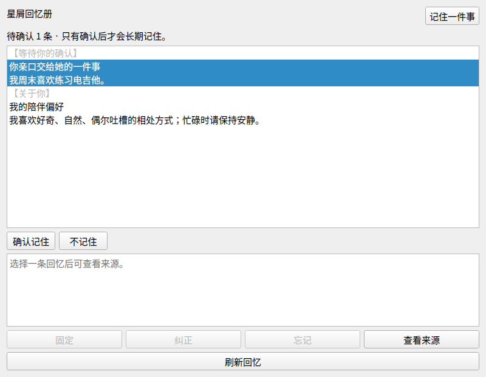

# E-Moti Personal Companion 第一批升级交付

研究与实施日期：2026-10-25。基线：`b9f200955123790a5c66abcaf4e2567b3659a90e`。本批实际修改 Python/PySide6 本体，完成记忆生命周期与稳定人格入口；Relay、游戏 Agent、硬件固件不在改动范围。

最新入口：[2026-10-29 Claude/Codex交接](../handoff/20261029/README.md)，汇总完整需求、角色分工与提示词；手机范围更正为Android/HyperOS、iOS、华为手机原生鸿蒙。此前macOS研究保留历史，不再安排Mac桌面任务。

后续增量：见 [2026-10-28 多端 Personal Agent 研究与实现](mobile/README.md)，包含持久任务监督和短时观测。下表保留第一批记忆/人格文档。

## 建议阅读顺序

| 文档 | 内容 |
|---|---|
| [verification.md](verification.md) | 已执行的测试、基线差异、38 条对照结果与未验证边界 |
| [source-audit.md](source-audit.md) | 当前仓库基线源码审计，原有功能与断点 |
| [gap-matrix.md](gap-matrix.md) | 已有、原测试、本批实现、剩余差距逐项对照 |
| [architecture.md](architecture.md) | 人格/事实/共同经历/外部状态的职责和最终 prompt 链路 |
| [migration-and-recovery.md](migration-and-recovery.md) | 单一权威存档、一次迁移、遗忘语义、损坏与回退 |
| [memory-research.md](memory-research.md) | Letta、Mem0、Graphiti、Hindsight、MemOS、EverOS、OpenViking、Honcho |
| [companion-research.md](companion-research.md) | AIRI、Open-LLM-VTuber、OpenClaw、Hermes、N.E.K.O. 与四个商业产品 |
| [reuse-decisions.md](reuse-decisions.md) | 实际复用的 Graphiti 代码及各方案取舍 |
| [benchmark-spec.md](benchmark-spec.md) | 数据集、同 runner 新旧对照、指标定义、真实 bad case 与下一阶段实验 |
| [product-roadmap.md](product-roadmap.md) | 分阶段产品/工程目标与验收 |
| [handoff.md](handoff.md) | 下一个 Coding Agent 的入口、命令和不可破坏的不变量 |
| [portfolio.md](portfolio.md) | 可用于 AI 产品经理求职的成果表述与证据边界 |

核心结果不是“又接了一个向量库”，而是让已有记忆真正到达模型输入，并使纠正、遗忘和到期约束贯穿来源、派生物、旧聊天与在途结果。当前 deterministic benchmark 不调用真实模型；人格配置稳定不等于模型体验已通过验证。

图为本批代码在 PySide6 中渲染的合成数据界面，中文字体由验收环境临时加载，不修改用户系统或内置角色资产。
