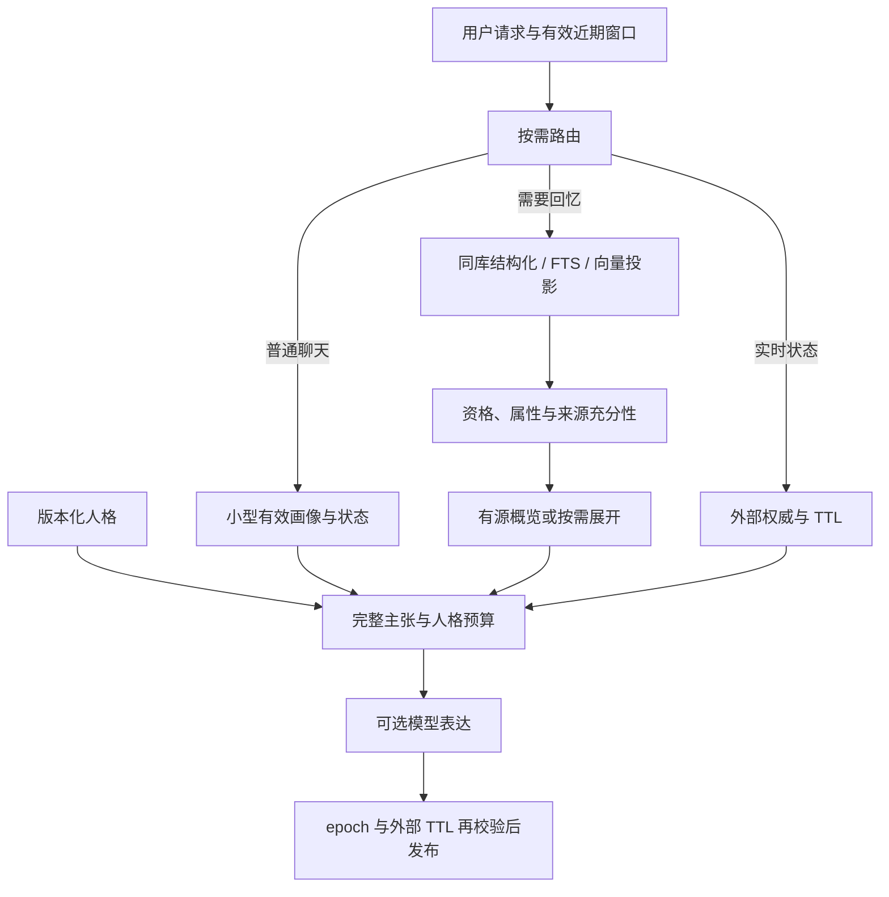
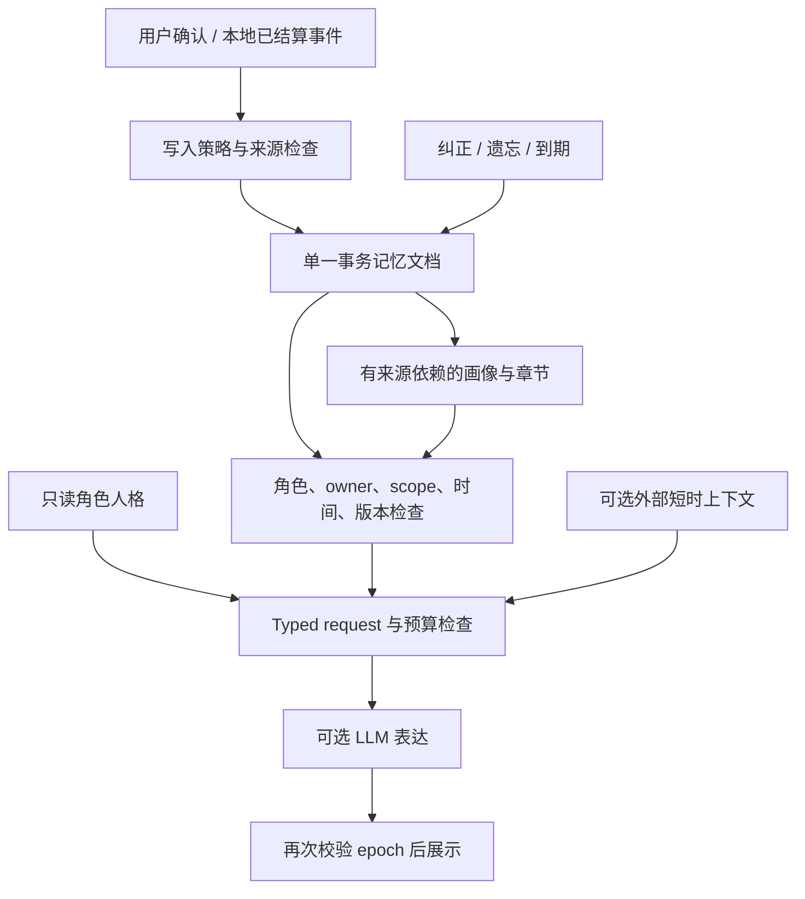

# E-Moti 记忆与人格架构：当前实现与历史沿革

当前生产冻结为 `b5b43e2a83a392b56d11cd2c24f01a89bdf22364`；第二轮首次独立评分对应 `1eef5cb`，评测工具检查点为 `53cb836`。详细机制以 [2026-11-01 按需记忆架构](20261101-memory-upgrade/memory-architecture.md)、[检索契约](20261101-memory-upgrade/retrieval-contract.md) 和 [存储/迁移](20261101-memory-upgrade/storage-index-v1.md) 为准。本页提供现行总览，并保留第一批架构沿革，不另立一套实施方案。

此架构已有生产接入，但新检索泛化验收未通过：独立 strict 7/33、证据召回 0.2121；修复既有主体优先级后的重放仍不改变这一结论。质量发布阻断和具体整改见 [默认路径评估](20261101-memory-upgrade/retrieval-release-assessment.md)。

## 当前实现：单一权威、按需读取与稳定人格

现有 Python/PySide6、Character Pack、关系/情绪状态机和 Plugin Runtime 保留。人格配置按版本直接读取，不由一次聊天或检索结果重写。长期事实仍由同一 SQLite 中的 `memory_state.payload` 权威 JSON 保存；结构化行、FTS、来源依赖、阶段概览和持久向量均为可重建派生层。已经移除 300 条权威留存上限；有界候选预算限制一次读取量，不删除较早的真实存档。

| 职责 | 当前生产机制 | 实际边界 |
|---|---|---|
| 稳定人格 | `PersonaProfile`、角色配置版本/hash、必需字段预算保护 | 配置稳定、正确进入 Prompt、实际模型行为稳定是三层验证；没有自动人格改写 |
| 用户事实与偏好 | subject/predicate/alias 结构化查询，来源指纹与有效期；有界 JSON 事实值、0/false、显式纠正和类型安全的口头遗忘 | 新类型需字面来源支持；复杂自由语言的事实正确性与完整双时间状态机尚未完成 |
| 共同经历与阶段回忆 | 有实际完成来源的事件；可重建目录、有来源摘录 L1、按需原始记忆卡 L2；依赖失效后拒绝旧概览 | L2 是当前存储卡片，不等于会话/执行日志全文或 claim/span 级原文 resolver |
| 任务经验与实时状态 | `task_experience` 的应用/版本/结果过滤；外部权威接口的版本、来源、TTL；复用旧经验时要求验证当前前提 | 过去成功不保证当前可用；未接入真实 Relay/手机/游戏时明确不可用，不凭旧记录宣布任务完成 |
| 近期会话与动态情绪 | 当前 epoch 的有界窗口、现有情绪/关系规则、可关闭工作插件的陪伴路径 | 情绪只影响表达，不改事实；无逐句来源的旧历史仍采用较粗的 epoch 隔离 |
| 维护与语义索引 | 有界单 worker 巩固、manifest 增量、同库持久向量、跨进程恢复、撤销后清理 | 尚非完整历史的断点扫描；向量相似度不是事实正确概率；首次准备和实际写入仍有成本 |

当前默认上下文路径为 `build_context → retrieve`；保留 `build_legacy_context` 作为旧算法对照。普通闲聊使用人格、近期状态和有依据的小型画像，不每句扫描所有长期记录。事实、经历、任务和实时状态按所需证据走不同来源；不确定请求只有有界补查。候选必须先满足 owner、角色、scope、时间、撤销和来源版本要求，再通过相关性及充分性判定。允许零条结果，也允许只回答混合请求中有依据的部分。

更正、遗忘与到期在现有事务中更新权威、撤销状态、索引及派生资格。已有来源的旧 writer 绕过正常 API 时，投影修复会补齐 epoch 屏障；检索提交、别名依赖、在途回复与后续历史都受当前版本约束。`sufficient` 仍只是本地证据策略判断，不能作为模型已经答对的证明。预算不足应移除完整主张并降级状态，不能把半条事实或失去依据的肯定答案留在 Prompt。

## 当前时间契约：桌面逻辑时间不是日历

实际桌面 `controller.self.now` 来自 `logical_time_from_state`，是互动/养成逻辑秒；`EmotionalMemoryService` 因此默认 `time_basis="logical"`。不能把旧数值解释成 Unix 秒，生成一个 1970 年日期，或与 2026 年的外部日历直接比较。Router 的独立 Unix 默认不改变桌面服务必须传递真实 time basis 的要求。

| 场景 | 当前行为 | 验证不能推导出的能力 |
|---|---|---|
| 原有桌面 logical 档案 | 当前事实和同域有效性继续工作；明确年月日/月窗口无法解析时返回 `insufficient / unresolved_time_basis_or_date` | 没有完成旧桌面存档的日历迁移；不能宣称角色已正确记得真实生活中的“上个月” |
| 显式 Unix 档案 | 使用调用者的 now 解析合法日/月半开窗口；事实按有效区间、事件/任务按发生时间，在 SQL 候选限额前筛选 | 合成 Unix 数据库的正确性不证明 Windows 桌面、时区/DST 或跨设备时钟偏差已经验证 |
| 后续真实时间迁移 | 保留旧逻辑值，只有有依据的日期才能补入；未知历史日期显式保留未知 | 不能靠缩放逻辑秒、当前系统时间或模型猜测制造旧事件日期 |

完整时间设计还需区分事件时间、系统记录时间、事实有效时间及原始来源的时间基准，明确“现实改变”“纠正旧错误”和“遗忘”的不同语义。进程内 monotonic 计时、墙钟与游戏逻辑时钟各司其职；当前已有时间字段和 TTL 不等于完整双时间数据库。逻辑档案的日期不足也不应使混合请求中的其他合法当前事实全部失去资格。

## 验证证据与后续顺序

最终评分、数据分母、真实 bad case、真实 embedding 与未执行项统一见 [本轮评测](20261101-memory-upgrade/ondemand-evaluation.md)。[存储测量](20261101-memory-upgrade/storage-index-v1.md#91-第二轮冻结源码的正式三尺度复测)和[持久向量验证](20261101-memory-upgrade/persistent-vector-cache.md)分别说明其源码版本与负载；不要把数据库快读、向量恢复或确定性 Prompt 测试写成真实模型答案/人格质量。最新全量测试与独立评测仍以实际落盘结果为准，本页不预填分数。

当前 JSON 权威使写入继续随规模增长，万条更正仍为秒级；同库投影的快读没有解决全部写锁和 GUI 卡顿。后续顺序只有 [当前产品路线](product-roadmap.md#2026-11-01-当前执行阶段) 一份：先核心检索质量、Claude 依据与未知体验、真实模型回答/人格评测；再处理桌面时间迁移、完整双时间与来源 span；依据写瓶颈论证单权威行式迁移；手机随后接入这些稳定接口。Relay、游戏 Agent 和 Body 固件继续独立，工作插件关闭不影响基本陪伴。

## 历史架构记录：2026-10-25 第一批增量

以下保留第一批代码的机制、取舍与当时未实现项。其中“本批”“当前”“下一阶段”均以 2026-10-25 为时间点；候选仅内存、300 条规模、尚无 embedding/索引、尚无后台维护等描述已经被上方当前实现替代，不是重新开发这些能力的任务清单。历史来源文档供追溯，最新完成状态只认 [本轮差距矩阵](20261101-memory-upgrade/ondemand-gap-matrix.md)。

日期：2026-10-25。实现依据与边界见 [源码审计](source-audit.md)、[差距矩阵](gap-matrix.md) 和 [验证记录](verification.md)。本文区分本批代码与下一阶段设计。

## 1. 产品原则与关键决定

E-Moti 的主体是可以独立生活在桌面的个人伙伴。角色身份、双方共同经历和相处方式属于 E-Moti；Relay 的任务真相、游戏 Agent 的世界状态属于各自系统。工作能力可以完全关闭，聊天、娱乐、休息和本地宠物循环仍可用。

本批沿用 Python/PySide6、Character Pack、现有关系状态机、Emotional Memory V2 的数据对象和 Plugin Runtime。新增的事务存储用于把事实与其失效信息一起提交，不另建向量数据库、图数据库或后台 Agent 服务。人格配置、用户事实、共同经历、动态情绪是不同责任，当前无需对应四套数据库。

最重要的不变量是：**只有在当前角色、owner、场景、时间和来源版本下仍有效的证据，才能进入下一次模型请求；一次聊天、纠正或遗忘不能修改角色的稳定身份。**

## 2. 数据职责

| 层 | 权威来源 | 本批实现 | 不能承担的职责 |
|---|---|---|---|
| 稳定人格 | 当前角色包、实际 performance profile、可选 `persona.json` | `persona.py` 白名单、大小限制、不可变对象、版本与配置 hash | 模型不能随对话重写；尚无自动人格演化 |
| 用户事实与偏好 | 用户主动添加/确认；已验证的宿主写入 | Entry 的来源、owner、scope、confidence、version、有效期、纠正链与退役记录 | 不从普通聊天任意推断用户事实；confidence 不是校准概率 |
| 共同经历 | 已结算的本地领域事件；明确确认的插件候选 | 沿用 first moments、礼物、日常、关系事件；来源 ID 与章节依赖 | 模型讲述的场景不因此成为实际经历 |
| 画像与阶段回忆 | 当前有效事实的派生视图 | CoreBondProfile 字段级 evidence；chapter 来源指纹；失效后禁止进入上下文 | 不作为独立事实真源；不允许靠重写摘要来掩盖删除失败 |
| 工作、游戏、感知 | 各插件/外部系统的当前状态 | 短时 plugin context；非 companion 的候选不写长期共同记忆 | 不能自动改变人格、亲密关系或真实个人事实 |
| 动态情绪与表达 | 本地情绪/关系规则、当前互动 | 原有状态机保留，当前角色设定真正接入表达策略 | 情绪不改事实；关系值不证明某次共同经历发生 |

`owner_id` 的存储隔离与 API 检查已加入；桌面 UI 仍是本地单用户产品，不宣称已有多账号登录或授权服务。

## 3. 一条完整读写链路

### 记住

用户可以在回忆册“记住一件事”中直接确认添加；聊天中的“请记住：……”生成可见候选，需在回忆册确认。普通聊天、LLM 回复和模型自报的共同经历不会自动获得写权限。待确认候选目前只保存在内存，重启后不恢复；需要持久候选箱时应为其单独定义过期和失效规则。

真实宿主事件可以按既有策略自动记为共同经历，但自动写入的 `user_confirmed` 保持 false。插件必须经过宿主边界；`user_confirmed=True` 不是从模型输出中读取的权利。当前 Python 插件属于宿主信任域，并非对恶意插件的进程沙箱。

### 正确召回

先检查角色、owner、deleted/retired、scope 和有效期，再计算词法/重要性/新近性等分数。可选 `semantic_retriever` 只接收通过硬过滤的条目，输出 ID→分数；异常回退本地词法检索。Graphiti RRF 仅用于排序融合，不能改变有效性。

**历史状态，现已替代：**第一批未安装 embedding 模型、未建立向量索引，当时以最多 300 条事实设计，SQLite 中保存一份 JSON 文档并在 Python 中检索。这是后来增加同库可重建投影与规模测量的原始依据，不是当前的规模或索引能力上限。

### 纠正与遗忘

`correct()` 在一个事务中退役旧条目、写入新版本、记录来源退役、移除关联派生信息并增加 `context_epoch`。原始发生时间和来源沿用，记录修改时间与版本单独变化。一般 `upsert`、批量保存和插件路径不能绕过退役检查。

`forget()` 的契约是从活动召回、派生视图和后续上下文中撤回；当前不是所有磁盘与远端副本的物理擦除。退役 ID 和来源留在事务文档，避免同一事件、legacy_key 或旧异步结果再次导入。用户之后主动重新表达一条事实可以形成新的用户事实；不能把“永远禁止任何相同字符串”当遗忘的实现。

### 派生信息同步失效

章节记录每个 source memory 的内容指纹；画像按字段值绑定来源。来源删除、内容更改或到期，相关派生对象立即失去模型可用资格。即使整理失败，也不回退使用旧摘要。旧版本没有来源的画像字符串保存在存档中，但不自动进入模型；旧章节仅在能够验证来源时使用。

**历史状态，现已替代：**第一批 `consolidate()` 和画像更新 API 具备来源与事务检查，当时没有后台自动巩固。当前已有有界单 worker 调度；仍保留提交时验证 epoch/来源、失败后丢弃或重算的要求，完整历史断点维护继续待做。

### 旧聊天、缓存与在途请求

新对话记录带有 `context_epoch`，兼容旧记录缺省值 0。纠正/遗忘/到期以后，之前 epoch 的聊天档案仍可供用户查看，但不再注入模型。这是一项保守选择：本批暂时丢弃整段旧上下文，牺牲部分无关聊天的连续性，换取来源缺失时可验证的撤回效果。

V2 成为表达层唯一长期事实入口；旧 `long_term_memory` 和 `memory_log` 不再作为平行 prompt 通道。感知、工具结果和旧反馈在 epoch 变化时失效。表达请求发送前、结果返回后都检查 epoch；异常 fallback 也必须检查，防止模型失败后重放旧事实。不能撤回已经送达远端模型的请求或已经被用户看到/听到的内容。

回忆册刷新和角色切换还会取消旧 TTS 队列、停止已创建 provider。内置 HTTP/Edge provider 在合成返回、开始播放之前检查 generation；SAPI 启动也检查取消状态。该保护已使用阻塞 fake provider 和真实线程队列回归，不等于已验证真实声音、远端请求取消或跨设备播放回执。旧音频缓存保持原有策略，不作为记忆 prompt 来源。

原有“记住称呼”操作接入有来源的 V2 画像，改名和清空会撤销旧来源。旧 `upsert_long_term_memory()` 的允许类别转发到 V2，同 key 更新版本，已经退役的 key 明确拒绝重放；新来源的显式用户确认可以重新记住，避免静默成功或按字符串误删独立事实。

### 人格稳定

人格 hash 只包含实际生效的角色设定，不包含心情、信任数值、记忆、时间或文件位置。纠正和遗忘事实不会触发人格重写。原先散落在表达策略中的星汐专用措辞，在启用新人格上下文时改为依据当前角色身份，避免切换角色后仍沿用同一模板。

这里保证的是配置边界与提示词连通性。模型能否持续表现得好奇、自然、偶尔吐槽但不过度讨好，需要真实模型和跨场景盲评；hash 不等于人格体验得分。

## 4. 提示词预算

原 provider 接口已有 8192 字符上限。真实接入记忆和人格后，合法大字段曾产生 13635 字符，导致请求无法发送。本批增加结构化预算：先移除非必要插件项、冗余章节及较低优先级内容，再减少低排名事实；保持 JSON 完整，不把一句事实任意截断成另一个意思。

预算使用字符数匹配现有 provider 验证；benchmark 中 UTF-8 字节数/4 只是粗略 token 估算。后续模型适配器应使用实际 tokenizer/usage，独立报告提示词占用、首 token 与完整响应延迟。

## 5. 外部能力的下一阶段契约

Relay、游戏 Agent 和 Body 只接入宿主插件 API，不改变本体状态机。建议外部 envelope 包含 `source_system`、`event_id`、`character_id`、`owner_id`、`scene_id`、`observed_at`、`expires_at`、`authority`、`scope`、`context_epoch`。该完整协议在本批是设计，不是已实现的互通 SDK。

任务“正在运行”、游戏“角色位于某处”、摄像头“看到物体”默认是短时状态。只有经明确产品策略确认的里程碑，才提议写成共同经历；提议仍应携带证据和来源。设备是同一人格的感知/表现端，不各自维护可互相覆盖的角色人格。

## 6. 当前代价与边界

本节标题与列表保留第一批原文语境。SQL 索引等已完成项不再属于现行缺口；当前写入成本、日历、双时间、原文展开和跨设备状态以页首总览及当前路线为准。

- 无来源旧画像不再进入模型，早期升级可能出现“少记住一点”的体验，应通过用户重新确认恢复证据，不能偷用旧摘要。
- 每个失效 epoch 会隔离一段旧历史，暂未实现句子级重建或精细来源图。
- JSON 文档置于 SQLite 解决原子提交，不宣称完成 SQL 索引优化、多设备同步、静态加密或物理安全擦除。
- 多次一致性检查增加少量本地 I/O；批量保存已避免每条反复序列化，但主 UI 仍需在 Windows 长时运行中测卡顿。
- 任意恶意 Python 插件能访问宿主文件，超出当前信任模型；权限清单不等于 OS 沙箱。
- 重启、合成数据、最终 prompt 和 Qt 离屏均已纳入验证；真实模型、实体设备、游戏环境和 Windows 音频仍独立验收。
