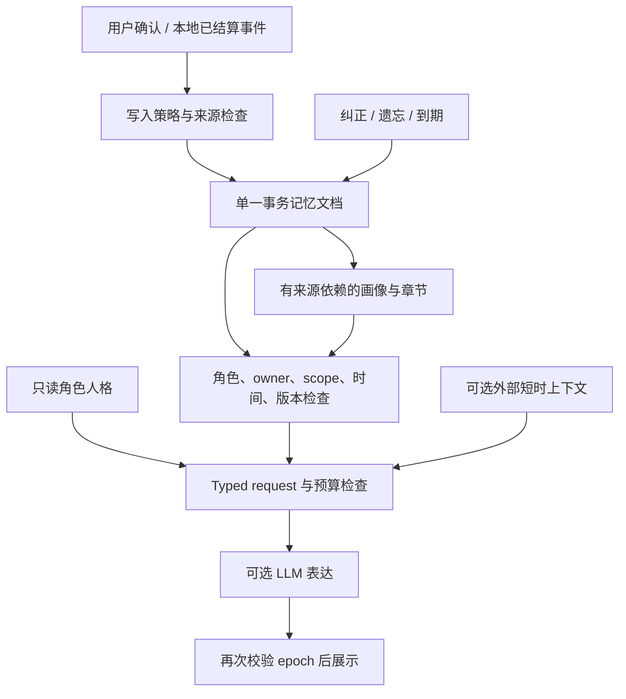

# E-Moti 记忆与人格架构：第一批增量实现

日期：2026-10-25。实现依据与边界见 [源码审计](source-audit.md)、[差距矩阵](gap-matrix.md) 和 [验证记录](verification.md)。本文区分本批代码与下一阶段设计。

## 1. 产品原则与关键决定

E-Moti 的主体是可以独立生活在桌面的个人伙伴。角色身份、双方共同经历和相处方式属于 E-Moti；Relay 的任务真相、游戏 Agent 的世界状态属于各自系统。工作能力可以完全关闭，聊天、娱乐、休息和本地宠物循环仍可用。

本批沿用 Python/PySide6、Character Pack、现有关系状态机、Emotional Memory V2 的数据对象和 Plugin Runtime。新增的事务存储用于把事实与其失效信息一起提交，不另建向量数据库、图数据库或后台 Agent 服务。人格配置、用户事实、共同经历、动态情绪是不同责任，当前无需对应四套数据库。

最重要的不变量是：**只有在当前角色、owner、场景、时间和来源版本下仍有效的证据，才能进入下一次模型请求；一次聊天、纠正或遗忘不能修改角色的稳定身份。**

## 2. 数据职责

| 层 | 权威来源 | 本批实现 | 不能承担的职责 |
|---|---|---|---|
| 稳定人格 | 当前角色包、实际 performance profile、可选 `persona.json` | `persona.py` 白名单、大小限制、不可变对象、版本与配置 hash | 模型不能随对话重写；尚无自动人格演化 |
| 用户事实与偏好 | 用户主动添加/确认；已验证的宿主写入 | Entry 的来源、owner、scope、confidence、version、有效期、纠正链与退役记录 | 不从普通聊天任意推断用户事实；confidence 不是校准概率 |
| 共同经历 | 已结算的本地领域事件；明确确认的插件候选 | 沿用 first moments、礼物、日常、关系事件；来源 ID 与章节依赖 | 模型讲述的场景不因此成为实际经历 |
| 画像与阶段回忆 | 当前有效事实的派生视图 | CoreBondProfile 字段级 evidence；chapter 来源指纹；失效后禁止进入上下文 | 不作为独立事实真源；不允许靠重写摘要来掩盖删除失败 |
| 工作、游戏、感知 | 各插件/外部系统的当前状态 | 短时 plugin context；非 companion 的候选不写长期共同记忆 | 不能自动改变人格、亲密关系或真实个人事实 |
| 动态情绪与表达 | 本地情绪/关系规则、当前互动 | 原有状态机保留，当前角色设定真正接入表达策略 | 情绪不改事实；关系值不证明某次共同经历发生 |

`owner_id` 的存储隔离与 API 检查已加入；桌面 UI 仍是本地单用户产品，不宣称已有多账号登录或授权服务。

## 3. 一条完整读写链路

### 记住

用户可以在回忆册“记住一件事”中直接确认添加；聊天中的“请记住：……”生成可见候选，需在回忆册确认。普通聊天、LLM 回复和模型自报的共同经历不会自动获得写权限。待确认候选目前只保存在内存，重启后不恢复；需要持久候选箱时应为其单独定义过期和失效规则。

真实宿主事件可以按既有策略自动记为共同经历，但自动写入的 `user_confirmed` 保持 false。插件必须经过宿主边界；`user_confirmed=True` 不是从模型输出中读取的权利。当前 Python 插件属于宿主信任域，并非对恶意插件的进程沙箱。

### 正确召回

先检查角色、owner、deleted/retired、scope 和有效期，再计算词法/重要性/新近性等分数。可选 `semantic_retriever` 只接收通过硬过滤的条目，输出 ID→分数；异常回退本地词法检索。Graphiti RRF 仅用于排序融合，不能改变有效性。

本批未安装 embedding 模型、未建立向量索引，没有以合成评分替代真实语义检索评测。短期仍以现有最多 300 条事实的规模设计，SQLite 中存一份 JSON 文档，检索在 Python 中执行。规模增长后应先测实际 P95 与写入频率，再考虑同一权威库之上的可重建索引。

### 纠正与遗忘

`correct()` 在一个事务中退役旧条目、写入新版本、记录来源退役、移除关联派生信息并增加 `context_epoch`。原始发生时间和来源沿用，记录修改时间与版本单独变化。一般 `upsert`、批量保存和插件路径不能绕过退役检查。

`forget()` 的契约是从活动召回、派生视图和后续上下文中撤回；当前不是所有磁盘与远端副本的物理擦除。退役 ID 和来源留在事务文档，避免同一事件、legacy_key 或旧异步结果再次导入。用户之后主动重新表达一条事实可以形成新的用户事实；不能把“永远禁止任何相同字符串”当遗忘的实现。

### 派生信息同步失效

章节记录每个 source memory 的内容指纹；画像按字段值绑定来源。来源删除、内容更改或到期，相关派生对象立即失去模型可用资格。即使整理失败，也不回退使用旧摘要。旧版本没有来源的画像字符串保存在存档中，但不自动进入模型；旧章节仅在能够验证来源时使用。

本批 `consolidate()` 和画像更新 API 已支持来源与事务检查，但没有新增后台自动巩固循环。下一阶段整理任务应读取 epoch，产生候选，提交时再验证 epoch 和来源版本，失败后丢弃或重算。

### 旧聊天、缓存与在途请求

新对话记录带有 `context_epoch`，兼容旧记录缺省值 0。纠正/遗忘/到期以后，之前 epoch 的聊天档案仍可供用户查看，但不再注入模型。这是一项保守选择：本批暂时丢弃整段旧上下文，牺牲部分无关聊天的连续性，换取来源缺失时可验证的撤回效果。

V2 成为表达层唯一长期事实入口；旧 `long_term_memory` 和 `memory_log` 不再作为平行 prompt 通道。感知、工具结果和旧反馈在 epoch 变化时失效。表达请求发送前、结果返回后都检查 epoch；异常 fallback 也必须检查，防止模型失败后重放旧事实。不能撤回已经送达远端模型的请求或已经被用户看到/听到的内容。

回忆册刷新和角色切换还会取消旧 TTS 队列、停止已创建 provider。内置 HTTP/Edge provider 在合成返回、开始播放之前检查 generation；SAPI 启动也检查取消状态。该保护已使用阻塞 fake provider 和真实线程队列回归，不等于已验证真实声音、远端请求取消或跨设备播放回执。旧音频缓存保持原有策略，不作为记忆 prompt 来源。

原有“记住称呼”操作接入有来源的 V2 画像，改名和清空会撤销旧来源。旧 `upsert_long_term_memory()` 的允许类别转发到 V2，同 key 更新版本，已经退役的 key 明确拒绝重放；新来源的显式用户确认可以重新记住，避免静默成功或按字符串误删独立事实。

### 人格稳定

人格 hash 只包含实际生效的角色设定，不包含心情、信任数值、记忆、时间或文件位置。纠正和遗忘事实不会触发人格重写。原先散落在表达策略中的星汐专用措辞，在启用新人格上下文时改为依据当前角色身份，避免切换角色后仍沿用同一模板。

这里保证的是配置边界与提示词连通性。模型能否持续表现得好奇、自然、偶尔吐槽但不过度讨好，需要真实模型和跨场景盲评；hash 不等于人格体验得分。

## 4. 提示词预算

原 provider 接口已有 8192 字符上限。真实接入记忆和人格后，合法大字段曾产生 13635 字符，导致请求无法发送。本批增加结构化预算：先移除非必要插件项、冗余章节及较低优先级内容，再减少低排名事实；保持 JSON 完整，不把一句事实任意截断成另一个意思。

预算使用字符数匹配现有 provider 验证；benchmark 中 UTF-8 字节数/4 只是粗略 token 估算。后续模型适配器应使用实际 tokenizer/usage，独立报告提示词占用、首 token 与完整响应延迟。

## 5. 外部能力的下一阶段契约

Relay、游戏 Agent 和 Body 只接入宿主插件 API，不改变本体状态机。建议外部 envelope 包含 `source_system`、`event_id`、`character_id`、`owner_id`、`scene_id`、`observed_at`、`expires_at`、`authority`、`scope`、`context_epoch`。该完整协议在本批是设计，不是已实现的互通 SDK。

任务“正在运行”、游戏“角色位于某处”、摄像头“看到物体”默认是短时状态。只有经明确产品策略确认的里程碑，才提议写成共同经历；提议仍应携带证据和来源。设备是同一人格的感知/表现端，不各自维护可互相覆盖的角色人格。

## 6. 当前代价与边界

- 无来源旧画像不再进入模型，早期升级可能出现“少记住一点”的体验，应通过用户重新确认恢复证据，不能偷用旧摘要。
- 每个失效 epoch 会隔离一段旧历史，暂未实现句子级重建或精细来源图。
- JSON 文档置于 SQLite 解决原子提交，不宣称完成 SQL 索引优化、多设备同步、静态加密或物理安全擦除。
- 多次一致性检查增加少量本地 I/O；批量保存已避免每条反复序列化，但主 UI 仍需在 Windows 长时运行中测卡顿。
- 任意恶意 Python 插件能访问宿主文件，超出当前信任模型；权限清单不等于 OS 沙箱。
- 重启、合成数据、最终 prompt 和 Qt 离屏均已纳入验证；真实模型、实体设备、游戏环境和 Windows 音频仍独立验收。
