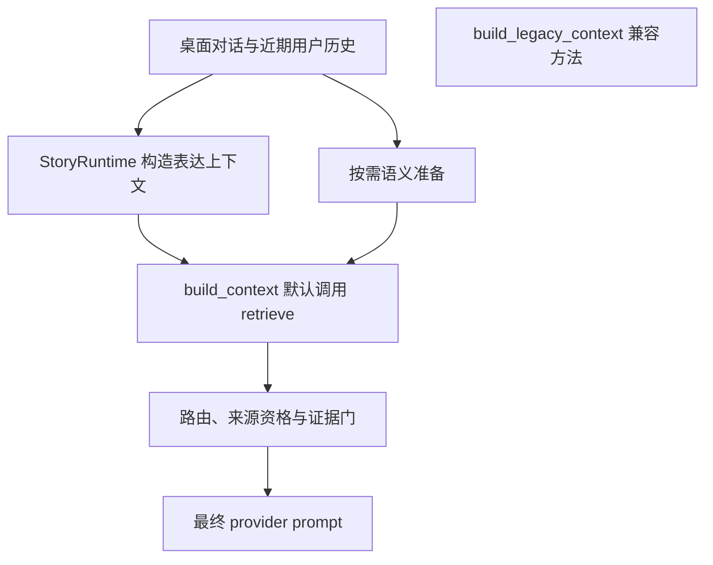

# 第二独立留出后的默认集成风险审查

审查性质：只读。生产冻结 `1eef5cb`、评测工具冻结 `53cb836`。本审查不修改代码、金标或首次独立结果。

## 真实默认路径

`EmotionalMemoryService.build_context()` 无条件调用 `retrieve(...).bundle`。`CompanionStoryRuntime.build_expression_context()` 调用该方法，传入 `recent_dialogue`；实际桌面使用的新读取路径因此已经替换了旧路径，并不只是一个独立可选 benchmark API。

`PluginEnabledCompanionController.prepare_semantic_recall()` 调用 `memory.prepare_retrieval()`，按新路由决定是否准备 embedding。`build_legacy_context()` 仍是可调用的旧实现，但当前没有用户可选择的检索模式参数，也没有 UI/配置开关把默认行为切回这一方法。`layered=False` 只切换概览表示，仍经过新路由与充分性门；关闭 semantic 也不会绕开这些门。

图中旧兼容方法没有被默认调用。旧方法仍使用同一升级后的权威存储、版本和撤回机制；若以后选择兼容策略，语义准备也需要与所选策略一致，不能只改上下文方法却继续让 fact 路径跳过旧方法所需的语义准备。

## 质量回归的实际证据

第二未见集 33 道有依据问题，新路径仅 7 道严格支持交付，26 道完全无证据。原 BGE 交付召回 0.6970，新路径 0.2121；严格交付 6/33→7/33 的净变化隐藏了新增正确5、丢失原正确4。4道原本可交付题的内容在真实库中仍存在，新路径因自然语言/上下文门未能交付。这个回退会直接影响当前桌面，而不是只有评测脚本可触发。

无答案注入 0/10 和禁止来源注入 0/48 同样是真实改善，说明不能简单把旧行为描述为可靠。两条路径的错误方向不同：旧路径倾向把主题相似但不应回答的来源放入 prompt；新路径过于拒绝。默认新路径可能令用户产生“记住了却总说没有记录”的体验，削弱共同生活连续性。稳定人格配置送达48/48不能弥补这项回忆行为缺失。

## 风险分层

| 层 | 当前证据 | 风险与下一步要求 |
| --- | --- | --- |
| 资格、撤回、隔离 | 同库索引、epoch、fingerprint和回归测试，独立集禁止来源0/48 | 保持硬约束；不能靠 fallback 绕过 owner、scope、版本、撤回/到期校验 |
| Router | 独立路由14/48，多余检索4/5 | 尺寸、数量、自然步骤和条件/解释子句超出确定性语法覆盖；需要广泛语言族验证和有界复杂路径 |
| 候选 | 26个正例失败里10个gold无decision；部分由错误route/scope/时间造成 | “没有decision”不能一律归因词法算法；需区分路由未读、资格排除、FTS/semantic候选遗漏 |
| 证据充分性 | 多数剩余gold已进入decision却被字面/主题门拒绝 | 可研究类型化属性约束加可校准的相关性/蕴含补充，保留同主体错字段、相近数值/单位与未知原因负例 |
| 多轮状态 | 新独立 follow-up1/6 | “那如今这一版”“我的那只”等需要有来源的当前指代状态；不能靠把更多字词加入正则达到可靠连续性 |
| 展示与模型 | provider预算未丢证据0/48，L1四claim全部有效；模型生成not_run | 问题主要发生在读取/门控前，不应通过更长prompt或更谄媚的人格掩盖；自然未知仍需真实生成与盲评 |
| 时钟 | 桌面逻辑时钟；Unix评测显式启用 | 真实桌面日历查询尚未迁移，必须说明未解析，不把逻辑秒当Unix日期 |

## 默认发布判断

当前数据不足以把新读取路径当作“全面提升长期陪伴质量”的默认替代。建议合并/发布审查把**存储与生命周期的可复用升级**和**尚未达标的语言门控策略**分开验收。新路由应有明确的候选/实验状态和可回退的策略边界；这个建议本轮未变成新的源码，不能写成已实现开关。

不建议“新路径空结果就自动注入旧top-k”：未知题本来就应为空，而旧BGE在未知集10/10有注入；这样的兜底会直接破坏目前得到的无答案控制。若以后加入候选扩展或备用验证，所有来源资格屏障必须保持，且扩大证据与最终允许陈述应分开，不把相似度当正确概率。

下一版的验收必须分别报告：全体有证据交付、未见语言族、旧正确题的丢失数、无答案和错误主体/字段、长会话指代、跨步骤任务条件、实际回答与未知自然度。修复过的这48题进入回归，另写独立数据；不得继续拿本轮已读题目宣称未见提升。
