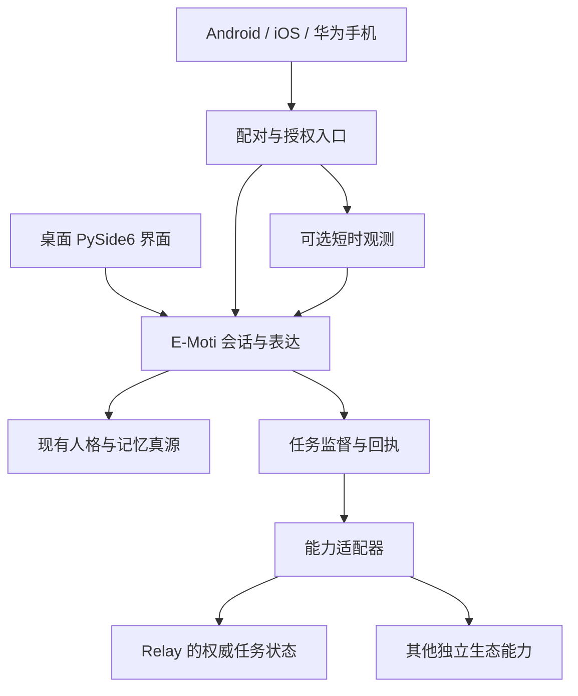

# 多端 Personal Agent：产品与工程方案

日期：2026-10-28（America/Los_Angeles）；2026-10-29按用户更正更新平台范围。本批代码基于上一批本地提交 `fa19b2c` 继续；当时GitHub main为`b9f2009`，没有open PR。实现和验证范围见 [verification.md](verification.md)。当前开发入口是[Claude/Codex交接](../../handoff/20261029/README.md)，平台依据见[Android研究](android-research.md)、[iOS补充研究](../../handoff/20261029/ios-research.md)及[华为手机与历史平台资料](platforms-research.md)。

## 1. 本次决定

E-Moti 的人格、共同记忆与陪伴体验继续独立存在。手机成为新的交互入口；电脑或用户选择的常开主机维护连续会话和已批准的长任务。Relay 继续拥有自己的任务、执行者、权限和验收状态。E-Moti 提出建议、传递用户意图、核对进度和解释结果，不重新接管 Relay 的内部调度。

第一阶段优先 Android 原生薄客户端；复用 Python/PySide6 的领域代码和现有长期记忆。手机普通功能不要求 root，也不要求先授予观测权限。手机聊天、电脑任务控制、手机活动观测分别可用和关闭，工作插件关闭后仍能聊天、娱乐与休息。

这轮实际新增的是两个可独立测试的 Python 内核和运行演示：持久任务镜像、短时观测上下文。**尚未实现可安装 APK、配对/鉴权、远程 API、真实 Relay adapter、后台轮询器、手机推送或观测 UI。**下面的目标结构不是当前已经上线的网络拓扑。

## 2. 目标结构与权威划分

| 内容 | 权威来源 | 其他端如何使用 |
|---|---|---|
| 角色身份、风格、关系与长期记忆 | 当前选定的 E-Moti 主机与角色包 | 同步版本和必要展示；模型不能各自改写人格 |
| 用户刚刚发出的指令/批准 | 已认证用户在明确会话中的操作 | 保留请求 ID、批准的目标和内容；屏幕文字不是批准 |
| 工作任务、执行进度、产物与验收 | Relay 或实际执行器 | E-Moti 保存关联 ID、最后确认状态、时间和证据引用 |
| 手机当前使用或可见内容 | 被授权的手机采集器 | 短期、带来源与有效期；不默认进入事实/关系记忆 |
| 用户是否在线、当前前台设备 | 每个设备的连接/显示回执 | 影响汇报渠道，不推断感情变化或要求回应 |

当前每个角色的记忆真源仍沿用上一批事务存储。任务 journal 与长期记忆是不同责任：前者保存批准与外部回执，后者保存伴侣事实。新增任务 SQLite 不存第二份用户画像，不引入向量库/图数据库。

### 在线与离线

默认采用电脑托管：手机可远程聊天、看任务、发送请求。手机断线后，已经被执行主机接收的任务可继续；手机回来后补拉事件。**电脑休眠、断电或网络不可达时，不能保证电脑工作继续。**界面显示最后确认时间和待恢复状态，不生成想象中的进展。

未来可增加用户自选常开主机，让聊天和监督不依赖某一台电脑开机。电脑上的实际执行仍取决于电脑在线；把记忆真源迁到常开主机要有显式迁移，不能同时启动互相覆盖的两份完整画像。首批不做多主写入或离线记忆 CRDT。

离线手机可以显示用户允许缓存的内容和“待发送”消息；不能把排队等同于已执行。对长期记忆撤回，离线端无法即时接收，因此恢复连接时先应用失效记录，再加载新上下文。敏感内容缓存应有短租期；若要支持离线自由对话，需要单独说明记忆新鲜度和未同步状态。

## 3. “主动、长程、可靠”的具体行为

### 主动：建议有理由，采纳后进入任务

建议可以来源于用户长期目标、用户主动分享的内容、明确的任务阻塞、共同兴趣；工作只是其中一种来源。保留现有 `ProactiveCompanionService` 的安静时段、全局冷却和拒绝后退避，以及 `FocusBreakPolicy` 的间隔/稍后逻辑。后续扩展这些现有入口，不并列再建一个无差别提醒引擎。

任务建议应显示：为什么现在提出、建议做什么、执行到什么程度、预计消耗、可停止的位置。用户“采纳”后，对批准内容生成稳定请求 ID。修改目标、执行范围或权限后需要新的批准；普通进度查询和批准范围内的继续执行无需反复询问。

例子：用户主动分享一篇想看的游戏攻略，E-Moti 可以建议整理对照表；用户没有采纳，就不派任务、不持续催促。用户请求跟进 Relay 中已存在的开发任务后，可以按阶段报告测试和交付；不能因为打开 B站就自行决定用户“应该去工作”。

本批代码只实现建议、采纳、派发前记录和回执。自主发现建议、自动规划、计划预算/期限与自动后台继续运行尚未实现。`approve()` 是受信宿主入口，未来 UI/认证层必须将它与真实用户操作绑定，不能把模型输出的 `approved=true` 转成授权。

### 长程：保存继续所需的状态

E-Moti 保存任务 ID、批准原文、目标执行器、唯一 command ID、外部任务 ID、最后观察序号、阶段说明、结果引用和取消意图。手机退到后台不丢这些信息。外部工作流已经由 Relay 承担时，E-Moti 只做监督记录，不复制它的计划图和 worker 调度。

下一批 runner 应依据 `due_for_check()` 查询权威状态，采用限频、退避和用户定义的阶段汇报频率；依赖恢复或新的批准才触发继续动作。手机推送只是提醒用户有更新，任务记录才是事实来源。推送丢失不等于任务失败，收到推送也不等于已验收。

任务报告先用程序生成事实卡片，再让角色补一两句表达。事实卡片至少含：执行者报告的状态、最后核对时间、完成了什么、证据链接、阻塞和下一步。模型不能把“已生成文件”改写成“测试全部通过”。

### 可靠：可检验的契约

| 目标 | 本批已经测试的行为 | 下一阶段仍需验证 |
|---|---|---|
| 获批的内容不被偷换 | 相同 proposal key 同内容幂等；内容不同报冲突 | 真正 UI 展示与批准绑定、权限/预算策略 |
| 不因重连重复派工 | 派发前事务保存 command ID；同任务只领取一次 | 下游去重、通过 command ID 查询；真实网络失败 |
| 不把未知说成成功 | 未知投递/过时进度需要核对，回执只表示 accepted | UI 标签、推送、真实模型总结准确性 |
| 保留阶段进展 | 外部事件的序号、来源、检查点与证据持久化 | 持续 runner、事件订阅、断线补拉 |
| 取消可解释 | cancel requested 与 cancelled 分开；完成/取消竞态保留真实回执 | 实际执行者是否支持取消及真正停止时刻 |
| 不串用户、角色或 attempt | 固定 namespace 与外部关联 ID 校验 | 认证设备到 namespace 的绑定 |
| 结果可核验 | succeeded 必须有引用，标为 reported_by_authority | 文件可访问性、测试真实性、独立或人工验收 |
| 观察不冒充事实/指令 | 无自动 memory/command 写入；来源、范围、有效期检查 | 模型对提示注入的抵抗、端到端派生信息撤回 |

这不是“远程恰好执行一次”的保证。领取后、发出前崩溃也可能导致任务没有被发出。正确恢复需要按 command ID 查询外部状态；下游不支持查询或幂等时，保留未知状态并由用户明确决定下一次尝试，不擅自重发有副作用的动作。即便使用 Temporal，其 MCP 文档也说明超时不自动取消已在执行的请求，工具仍需幂等。[官方机制说明](https://docs.temporal.io/develop/python/integrations/mcp)

## 4. 手机观测怎样帮助理解用户

优先级是：**用户主动分享 → 应用级使用事件 → 允许的媒体元数据 → 用户开启的屏幕会话 → 经验证的无障碍适配**。每增加一层，都说明新增可见内容和系统授权。用户可以只开第一层，工作控制和普通聊天不受影响。

产品上可以有一个“手机观测”总开关；底层必须按来源和 App 管理。权限状态至少区分未授权、已暂停、正在采集、系统限制、来源不提供内容和离线。总开关关闭必须同时停止采集、停止上报、取消待处理结果并使相关上下文失效。

| 信号 | 合理解释 | 不能直接成为长期事实 |
|---|---|---|
| B站前台 20 分钟 | 使用事件表明该 App 活跃 | 用户喜欢某位主播或完整看过某视频 |
| 播放器公开一个视频标题 | 当前播放器提供了该元数据 | 视频内容都被用户接受或记住 |
| 微信通知含一句话 | 来自该通知源的可见文本 | 对方的话就是用户观点、完整聊天已被读取 |
| 屏幕摘要出现旅行地点 | 当前画面可能与地点相关 | 用户已经出行、常住该地或计划确定 |
| 用户说“我就是喜欢这种表达” | 明确的偏好候选，可让用户确认 | 永久不可改变的人格规则 |

“语料”也需要说话者归属：用户本人发出的文字、对方的回复、网页内容、角色扮演和系统文案不能混在一起学习用户风格。第一版适合在用户选择的对话片段上提取可检查的风格偏好，不做全天收集后直接微调模型。学习到的候选仍使用现有来源、确认、纠正与遗忘链路。

### 本批观测代码的范围

`device_context.py` 接收五类已经规范化的数据：`user_share`、`app_activity`、`notification`、`accessibility_text`、`screen_summary`。普通使用记录不能夹带正文。屏幕只接短摘要，不接原图、视频或任意 JSON；本批没有 OCR/VLM/采集实现。

`ObservationPolicy` 默认无任何能力和 App；授权记录只在 RAM。默认保留 300 秒，可设 1—3600 秒；最大 24 条，模型视图最多 2 条且不超过 2100 字符。身份只读；切角色应关闭旧 buffer 后新建。每次重新授权、记忆 epoch 前进、撤销和重启都会令旧票据无效；普通新增观察不会取消仍有效的回复。

字段包含事件 ID、设备/owner/角色、采集时间、来源方法、应用 ID、当前 memory epoch 和会话票据。`sensitive` 只是采集器上报的已知敏感标记，**不是检测银行、密码或无痕页面的算法**。来源未能识别隐私状态时，UI 和 collector 必须按实际能力降级；不能因为字段是 false 就宣布内容安全。

上下文带 `scope=observation`、`trust=untrusted_observation`、`memory_write_allowed=false`。这些是宿主数据约束，不是模型层面的提示注入防护证明。外部页面出现命令文本不会由此模块触发执行，任务批准只走独立用户入口。

### 为什么这轮不自动接入桌面聊天

只把手机摘要塞进 `plugin_context`，然后清空 buffer，不能阻止旧摘要从模型回复、聊天历史、语音队列和客户端缓存中再次出现。上一批的长期记忆失效已解决其自身证据链；新的手机来源还需要端到端接入同等撤销契约。

因此当前 buffer 明确提供 `is_current(view, now=...)`，但不自动注册到现有 controller 或 UI。运行演示验证了 typed request/prompt 能携带规范化视图，并验证撤回后该视图不可展示；**没有把它说成桌面历史/TTS/手机缓存已经全链路撤销**。

真实整合的门禁：模型调用前和呈现前检查观测版本；聊天派生条目保留观测来源与期限；旧来源过期/撤回时过滤派生历史；语音和所有在线设备接收取消；新 context epoch 与权限版本先于旧队列同步。关闭采集不等同于物理擦除此前用户主动保存的聊天或第三方模型记录，删除应是可查看范围的独立操作。

## 5. 接入协议与现有代码的连接点

传输层先采用普通 HTTPS 请求及前台事件流；手机恢复时补拉游标。Android 前台可用 WebSocket/SSE，后台不保证长连接存活。对于国内无 GMS 的设备，后续按实际环境评估厂商推送；核心状态不依赖 FCM。

配对使用成熟 TLS/认证设施。二维码可以承载主机地址和一次性配对信息，桌面显示并确认设备；长期凭据存平台安全存储，设备可单独撤销。不能将本批观察票据当作网络认证，也不能信任手机请求正文自报的 owner/character/authority。需要由已认证连接映射到宿主权限，再创建窄范围对象。

首批可以选用户已有的私有网络或 Tailscale Serve。Serve 默认目标是 tailnet 内访问，Funnel 是另一个公开网络功能；两者不要混用。以 Serve 身份头做认证时，后端只监听可信代理侧的 loopback 并按官方要求防直接伪造。没有给本项目配置任何 VPN、监听端口或公网服务。[Serve 官方文档](https://tailscale.com/docs/features/tailscale-serve)

| 契约责任 | 设计中的入口 | 当前状态 |
|---|---|---|
| 手机聊天 | 认证会话 → `DialogueRequest` → 现有表达链路 | Python 对话入口已有；远程路由未实现 |
| 任务建议/采纳/取消 | 认证操作 → `PersonalTaskStore` | 本批内核已实现；UI/传输未接 |
| 查询已派发任务 | command ID / external task ID → 权威适配器 | journal 有关联字段；真实 adapter 未接 |
| 阶段事件/报告 | 归一化 `TaskEvent` → `task_report` | 本批已实现；事件订阅/调度未接 |
| 手机观测 | 原生 collector → host-bound `Observation` → buffer | 本批接收/门控已实现；collector/完整消费链未接 |
| 记忆管理 | 已认证用户 → 现有回忆册服务 | 桌面闭环已实现；手机管理页未接 |

桌面 Qt UI 与远程入口应共享同一会话权威。先为现有 controller 增加小型宿主 facade 与命令队列，把外部请求序列化到正确线程；不要让 WebSocket 回调直接并发改 Qt 对象或同时创建多份相同角色存档写入器。协议使用不可变请求/结果对象，显示层仅负责呈现。

对 Relay 仅做了只读接口现状核对，没有修改其代码或复制实现。当前本项目没有验证过可直接调用的 Relay 远程 HTTP 接口。后续双方约定最小能力：能力发现、按批准内容提交、按 command ID 核对、读取任务、按游标读事件、取消及取消状态、结果引用。名称是接口责任，不是宣称现成端点。Relay 独立实现自己的授权和任务权威，E-Moti 不绕过它执行 Codex/Claude。

MCP 可以作为某些工具适配器的协议，但不是整套个人伙伴会话/移动同步协议，也不会自动提供任务持久化、授权、取消与已完成证明。当前不引入 MCP SDK 或 Temporal 运行依赖；当接口与复杂度确实需要时再固定版本集成。

## 6. 平台实现选择

| 平台 | 推荐方案 | 复用与额外工作 |
|---|---|---|
| Android / HyperOS 4 | Kotlin + Jetpack Compose 薄客户端，平台原生 collector | 复用 host 协议；独立处理权限、生命周期、分享、Keystore、录屏服务；不移植整套 PySide UI |
| iPhone / iOS | Swift/SwiftUI薄客户端及必要的系统扩展 | 复用host协议；分别处理分享、局域网权限、Keychain、APNs和按系统版本授权的屏幕会话；不依赖EU限定的数据导出 |
| 华为手机原生 HarmonyOS | ArkTS/ArkUI 薄客户端，必要时 C/C++ 录屏桥接 | 复用 host 协议与语义；分别实现授权、后台、分享和屏幕；系统级使用统计不承诺普通 App 可获权，不使用PC专属能力推断手机 |
| 可选网页/PWA | 聊天/任务的轻入口 | 可先验证交互，但不能替代原生手机全局观测；不能把它宣传成原生采集能力 |

用户已明确此前macOS为口误，不安排Mac桌面客户端。iOS的Mac/Xcode属于构建条件。当前主方案保持Python宿主和原生手机端；旧Qt/HarmonyOS资料的表述差异保留在平台研究中，不能据此直接承诺当前PySide工程可发布手机HAP。

## 7. 后续分批开发与验收

### M0：本次完成的基础与证据

官方/源码研究；不依赖外部执行者的任务监督内核；短时观测门控；失败用例、自动测试和可运行演示。原角色、存档、插件、桌面默认启动不改变。

### M1：手机与电脑的可用联通

实现宿主 facade、配对/认证、Android 聊天与任务页、断线重连、手机主动分享；接入实际可用的 Relay 只读状态，再增加已批准的提交/取消。两项目的接口需要在各自工作中完成，不能先造假端点来宣称接通。

验收：同一个人/角色跨端延续；错误设备不能发指令；请求重复/断线不重复派工；电脑离线明确显示；阶段报告能打开真实来源；工作插件关闭后聊天继续可用。真实模型、真实执行者、实际 APK 分别保留记录。

### M2：可用的长程监督

复用现有主动策略，增加任务预算/期限、检查间隔、退避、阻塞提示、阶段报告游标与读取回执；接上持续 runner。明确批准哪些后续动作，报告频率可选，安静模式不惩罚关系。测试至少跨进程重启、执行主机休眠/恢复、取消未知结果和一次真实跨小时任务。

### M3：手机观测的完整隐私链

在 HyperOS 4 真机先验 Usage Access、分享与媒体信息，再接 MediaProjection。最后才评估可访问性适配。落实聊天历史/派生摘要/语音/离线缓存的来源撤销；用户可查看采集空窗和删除范围。测量延迟、漏采、耗电；不对全应用/全版本承诺完整可见。

### M4：iOS与华为手机鸿蒙客户端

iOS先完成聊天/任务/主动分享和签名后的真实网络连接，再验证对应版本的屏幕会话；华为手机鸿蒙先同样的交互闭环，再验证普通签名下的录屏/辅助扩展。按当前[平台更正](../../handoff/20261029/platform-scope.md)保留权限和地区差异，共享协议和同一人格。Game Companion与Body继续独立演进，本线程不开发固件。

## 8. 后续评测建议

在既有 Memory Benchmark 之外建立 Device/Task Contract Suite：重复命令实际执行次数、错误成功声明、未知状态恢复、取消确认延迟、外部状态新鲜度、同源事件乱序、角色/owner 隔离、权限撤回到展示阻断的延迟、离线旧事实泄露、观察事实错误归属、提示注入引发的未授权动作、手机采集空窗和额外耗电。

本批 57 项 Python 测试和 18 项本地 smoke 检查只覆盖已实现内核，不是这些真机指标的测量结果。上一批记忆测试继续保留；真实模型人格一致性仍需独立评测，不能用 config hash 稳定代替。
